# 00 — Tóm tắt sản phẩm

**Một câu:** Hành trình Sao Kim là game web 3D mobile-first, biến website của doanh nghiệp thành một hành tinh đang ngủ; người chơi đi qua 5 trạm S–A–O–K–IM để thắp sáng nó, và nhận lại một bản chẩn đoán thương hiệu có bằng chứng cùng gói dịch vụ của Sao Kim Branding.

| Hạng mục | Giá trị |
|---|---|
| Tên | **HÀNH TRÌNH SAO KIM** — "5 trạm thắp sáng thương hiệu" |
| Chủ sở hữu | Sao Kim Branding |
| Nền tảng | Web, mobile-first, PWA; 3D realtime + fallback 2.5D |
| Thời lượng | 7–10 phút, mục tiêu ~8 phút |
| Người chơi | CEO/chủ doanh nghiệp SME Việt Nam (quyết định ngân sách thương hiệu) |
| Ngôn ngữ | Tiếng Việt |
| Mục tiêu kinh doanh | Lead chất lượng + lịch tư vấn đã đặt |
| Tài liệu liên quan | [01 Concept](01-concept.md) · [03 Game Design](03-game-design.md) · [04 Điểm & Gói](04-scoring-offers.md) · [10 KPI](10-kpi.md) |

## 1. Vấn đề

Doanh nghiệp SME Việt Nam thường không thiếu ý tưởng về thương hiệu — họ thiếu **một điểm nhìn khách quan rẻ, nhanh, đủ cụ thể để ra quyết định**. Bốn hệ quả thực tế:

1. **Ra quyết định bằng cảm tính.** Chọn màu, logo, thông điệp theo sở thích người sáng lập, không theo điều khách hàng thật sự dùng để chọn.
2. **Nhầm thương hiệu với logo.** Đầu tư một lần cho bộ nhận diện rồi mọi điểm chạm khác (ra mắt, nội bộ, vận hành) làm mỗi nơi một kiểu.
3. **Thuê agency theo deliverable.** Brief bắt đầu bằng "làm lại logo" thay vì "tôi đang mất khách ở đâu", nên dự án xong mà vấn đề vẫn còn.
4. **Không có chẩn đoán trước khi tư vấn.** Sales mất 30–60 phút gọi khám phá cho mỗi lead để biết có phù hợp không; khách mất một cuộc gọi để biết mình đang ở đâu.

Hành trình Sao Kim trả lời câu hỏi hẹp hơn và hữu ích hơn: *"Thương hiệu của tôi đang sáng ở lớp nào, tối ở lớp nào, và nếu phải làm một việc tiếp theo thì nên làm gì?"*

## 2. Concept

Mỗi thương hiệu là một **hành tinh đang ngủ**, bị sương che, mang tên doanh nghiệp nhưng chưa có ánh sáng riêng. Người chơi điều khiển con tàu mang logo của chính mình, đi qua 5 trạm; mỗi trạm trả lại **một lớp sáng** (khí quyển, trục quay, bề mặt, tín hiệu, vệ tinh). Ở cuối hành trình, ngôi sao 4 cánh màu cam–đỏ của Sao Kim xuất hiện: hành tinh được nhìn thấy, và những vùng còn tối chính là những bước người chơi chưa quyết.

Trợ lý AI **KIM** dẫn đường, gọi người chơi bằng tên thương hiệu, không bán hàng trong lúc chơi.

## 3. Năm trạm

| Trạm | Thế giới | Ẩn dụ | Người chơi làm gì | Lớp sáng |
|---|---|---|---|---|
| **S** — Scan Brand | Tinh cầu Sương Mù | Nhìn lại trước khi tin vào giả định | Rê tay quét sương 4 vùng, mở tín hiệu thật từ website, chọn tác động kinh doanh | Khí quyển |
| **A** — Align Strategy | Đài Thiên Văn | Chọn hướng, chấp nhận từ chối | Nối chòm sao Sứ mệnh–Tầm nhìn–Giá trị, đặt logo lên bản đồ định vị 2 trục, chọn 2 tính cách | Trục quay |
| **O** — Optimize Identity | Xưởng Chế Tác | Hệ thống nhìn thấy được, không chỉ logo | Soi 6 mockup gắn logo thật, tìm 2 mockup sai màu/font trong 15 giây, kiểm tra ghi nhớ màu | Bề mặt |
| **K** — Kickoff Communication | Bệ Phóng | Cất tiếng và đối mặt khủng hoảng | Xếp 5 việc ra mắt, giữ nạp và phóng tàu, xử lý khủng hoảng 30 giây | Đèn thành phố + sóng |
| **IM** — Implement Consistency | Trạm Vận Hành | Giữ lửa qua thời gian, con người, quy mô | Tua 12 tháng, xử lý 4 sự kiện, giữ đồng hồ "Độ nhất quán" | Vệ tinh |
| **Đích** | Sao Kim | Được nhìn thấy | Cinematic, mở báo cáo | Hành tinh hoàn chỉnh |

Chi tiết ẩn dụ và giọng điệu ở [01-concept](01-concept.md); thiết kế từng trạm ở [03-game-design](03-game-design.md); hình ảnh ở [06-storyboard](06-storyboard.md).

## 4. Cách hoạt động

```mermaid
flowchart LR
  L[Landing: nhập website] --> C[Crawl 3–8s<br/>hoặc nhập tay]
  C --> X[Xác nhận brand kit<br/>+ 2 câu quy mô/vai trò]
  X --> M[Bản đồ 5 trạm]
  M --> S[S] --> A[A] --> O[O] --> K[K] --> IM[IM]
  IM --> F[Cinematic Sao Kim]
  F --> R[Báo cáo ungated<br/>X/10 · danh hiệu · 2 bước yếu]
  R --> G[Lead gate + consent]
  G --> P[Báo cáo đầy đủ + gói + PDF]
  P --> CT[Đặt lịch · nhận báo giá · share 9:16 · leaderboard]
```

- **Không chặn lead từ đầu.** Điểm, danh hiệu, 2 bước yếu và teaser gói hiển thị trước khi xin thông tin.
- **Không bán hàng trong lúc chơi.** KIM không nhắc tên gói; gói chỉ xuất hiện sau báo cáo.
- **Có thể bỏ qua một trạm**, chơi tiếp; trạm bỏ qua tính 0 điểm và hiện là vùng tối.
- **Mỗi lần chuyển trạm là một chuyến bay.** 2,9 giây: cất cánh, bay qua vùng tối, hạ cánh; bỏ qua được. Bản đồ chỉ mở khi người chơi tạm dừng.
- **Mỗi quyết định là một popup một câu.** Câu hỏi mở ngay trong lúc chơi, có thể ẩn thành pill và mở lại; trả lời xong mới đi tiếp.

## 5. Khác biệt

| Điều thường thấy | Hành trình Sao Kim làm khác |
|---|---|
| Quiz marketing thu thập lead, câu hỏi rời rạc, đáp án đúng do người viết tự nghĩ | Quyết định nằm trong hành động của game; đáp án đúng là thực hành thương hiệu có thể giải thích được |
| "Audit miễn phí" sinh điểm số không có bằng chứng | Điểm trạm đến từ lựa chọn của người chơi; website thật cung cấp bằng chứng, reality check và tín hiệu mở đầu |
| Báo cáo tự động dài, chung chung, không ai đọc | Báo cáo 1 trang: tổng X/10, 5 lớp sáng, 2 bước yếu kèm hệ quả kinh doanh, 3 insight có evidence |
| CTA bán gói ngay trên landing | Gói chỉ xuất hiện sau khi người chơi tự thấy điểm yếu của mình; sales nhận lead có ngữ cảnh |
| Không có người thật phía sau | Lead gate nối vào CRM + SLA gọi lại; báo cáo PDF có QR |

## 6. Gói dịch vụ gắn với hành trình

Catalog thật (nguồn: `src/shared/offers.ts`, giá là khoảng tham khảo):

| Trạm yếu | Gói đề xuất | Thành phần | Giá |
|---|---|---|---|
| S / A | **Gói Nền tảng** | Brand audit + Chiến lược thương hiệu | 25–50 triệu · 120–300 triệu |
| O | **Gói Nhận diện** | Nhận diện thương hiệu + Brand guideline | 80–200 triệu · 40–80 triệu |
| K | **Gói Ra mắt** | Marcom + Profile/Brochure | Theo chiến dịch · 30–70 triệu |
| IM | **Gói Vận hành** | Brand guideline + Design request + Website care | 40–80 triệu · 8–20 triệu/tháng · 3–8 triệu/tháng |
| K + IM | **Gói Ra mắt & Vận hành** | Marcom + guideline + design + care | Theo chiến dịch + 40–80 triệu + 8–20 triệu/tháng + 3–8 triệu/tháng |
| O + K | **Gói Tăng tốc** | Identity + guideline + marcom + profile | 80–200 triệu + 40–80 triệu + theo chiến dịch + 30–70 triệu |
| ≥3 trạm yếu hoặc tổng <5 | **Gói Trọn bộ SAOKIM** | Toàn bộ 8 hạng mục | Tổng theo 8 dòng giá |
| Tất cả trạm ≥8 | **Gói Đồng hành** | Guideline + design + care | 40–80 triệu + 8–20 triệu/tháng + 3–8 triệu/tháng |

Quy tắc map, thứ tự ưu tiên và ví dụ tính ở [04-scoring-offers](04-scoring-offers.md).

## 7. KPI mục tiêu (giả thuyết)

Các số dưới đây là **giả thuyết cần đo trong 8 tuần đầu**, không phải cam kết. Đơn vị x/100.

| Chỉ số | Mục tiêu | Vì sao chọn |
|---|---|---|
| Bắt đầu chơi / vào landing | 35/100 | Game 3D có chi phí tải; dưới mức này phải xem lại landing |
| Hoàn thành 5 trạm / bắt đầu chơi | 30/100 | Đo chất lượng gameplay và độ dài phiên |
| Gửi lead / hoàn thành | 15/100 | Lead gate sau báo cáo, không chặn từ đầu |
| Lead đủ điều kiện (có ngân sách + đúng vai trò) / lead | 40/100 | Chất lượng lead quan trọng hơn số lượng |
| Đặt lịch / lead đủ điều kiện | 25/100 | Đo SLA và độ phù hợp của gói đề xuất |
| Share báo cáo / hoàn thành | 8/100 | Kênh lan truyền tự nhiên |
| Hoàn thành trên thiết bị tầm trung | 25/100 | Chất lượng kỹ thuật là điều kiện của phễu |

North star: **số lịch tư vấn đã xác nhận mỗi tuần**. Chi tiết phễu, event, SQL ở [10-kpi](10-kpi.md).

## 8. Phạm vi

**Trong phạm vi MVP:** landing + crawl + xác nhận brand kit; 5 trạm với 18 quyết định; tính điểm và báo cáo; lead gate + consent; PDF + QR; share 9:16; leaderboard theo ngành; PWA + resume; CRM outbox 1 chiều; AI insight có fallback template.

**Ngoài phạm vi MVP:** đăng nhập/tài khoản; thanh toán online; CRM 2 chiều; ngôn ngữ thứ hai; VO thu sẵn; benchmark ngành theo dữ liệu thật; sales console; A/B test tự động; asset 3D thật (Draco/KTX2).

## 9. Rủi ro chính

| Rủi ro | Dấu hiệu sớm | Đối sách |
|---|---|---|
| Người chơi bỏ giữa chừng | Rơi ở trạm O hoặc K | Resume 7 ngày, skip trạm, giảm thời lượng trạm O về 90 giây |
| Trang không crawl được | 403/timeout ở nhiều domain | Nhập tay điền sẵn domain; logo upload; monogram |
| Báo cáo bị coi là "phán xét" | Người chơi bỏ ngay sau báo cáo | Câu chữ "không phải thương hiệu yếu…", nhấn vào bước yếu như cơ hội |
| Lead rác vì gate quá dễ | Tỉ lệ đặt lịch thấp | Honeypot, xác thực SĐT/email, câu hỏi đại diện, SLA gọi trong 24h |
| Mobile yếu không chạy được 3D | Frame rate thấp, thoát trang | Tier low = 2.5D, cảnh báo nhẹ, mặc định poster |
| Dữ liệu cá nhân sai quy định | Thiếu consent, lưu quá lâu | Consent version, retention 180 ngày, IP hash, DPO `[cần xác nhận]` |

## 10. Đọc tiếp

- Muốn hiểu vì sao có 5 trạm: [01-concept](01-concept.md).
- Muốn build: [07-architecture](07-architecture.md) và [03-game-design](03-game-design.md).
- Muốn bán: [04-scoring-offers](04-scoring-offers.md) và [10-kpi](10-kpi.md).
- Muốn kiểm thử: [09-mobile-qa](09-mobile-qa.md).
