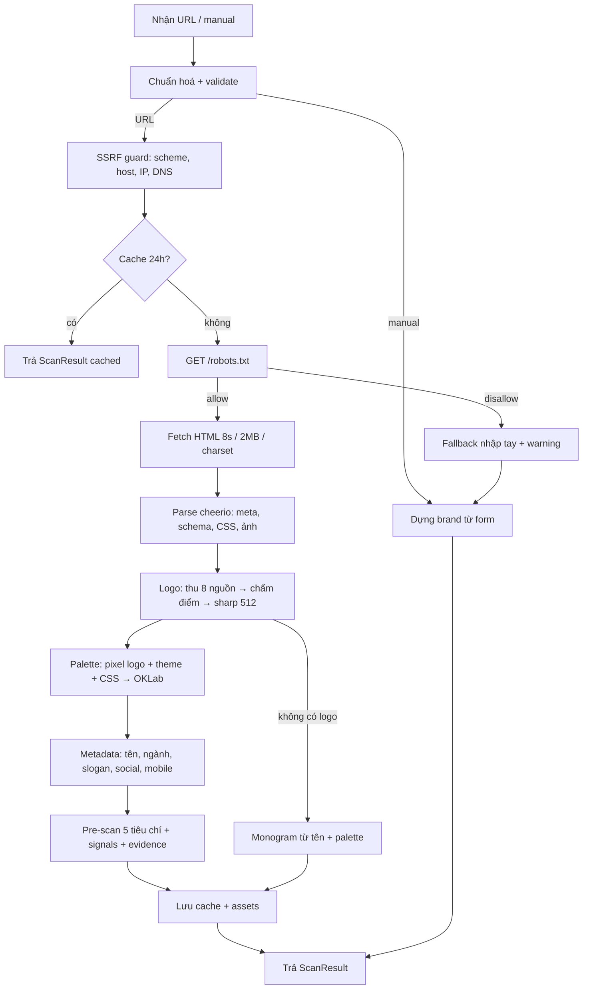

# 02 — Crawl & Brand Kit

Crawl là bước quyết định trải nghiệm: người chơi thấy website của mình hiện ra dưới dạng hành tinh có logo, màu, tên thật. Tài liệu chốt pipeline, tiêu chí chọn asset, thuật toán màu, pre-scan và toàn bộ nhánh lỗi. Code tương ứng: `server/crawl/**`, hợp đồng dữ liệu ở `src/shared/types.ts`, validate ở `src/shared/api.ts`.

## 1. Mục tiêu & ràng buộc

| Mục tiêu | Ngưỡng | Ghi chú |
|---|---|---|
| Thời gian có brand kit | 3–8 giây (p50 ≤ 4s, p95 ≤ 8s) | UI radar chạy tối thiểu 3s để không "nháy" |
| Tỉ lệ crawl thành công | 80/100 với domain SME Việt thông thường | Phần còn lại đi nhập tay, không chặn |
| Logo dùng được | ≥ 128px, nền trong suốt hoặc nền sạch | Chuyển PNG 512, same-origin |
| Dữ liệu lưu | Chỉ dữ liệu suy ra (tên, logo, màu, mô tả, social) | **Không lưu HTML, không lưu ảnh chụp trang** |
| Bảo mật | SSRF guard, robots.txt, giới hạn 2MB/8s | UA `SaoKimBrandScanner/1.0` |
| Lặp lại | Cache 24 giờ theo domain | Trùng domain trong ngày trả gần như tức thì |

Đầu vào: `POST /api/scan` với `{ url }` hoặc `{ manual: { name, website?, industry?, logoDataUrl? } }`. Đầu ra: `ScanResult` gồm `scanId`, `source` (`url`/`manual`/`fallback`), `brand`, `preScan`, `warnings[]`, `cached`, `fetchedAt`.

## 2. Luồng

Nguyên tắc: **mỗi bước có fallback riêng**; lỗi ở logo không làm hỏng crawl; lỗi ở crawl không chặn người chơi.

## 3. Chuẩn hoá & SSRF guard

| Kiểm tra | Quy tắc | Lý do |
|---|---|---|
| Scheme | Chỉ `https`, tự nâng `http` → `https` một lần | Tránh nội dung không mã hoá |
| Host | Bỏ `www.`, lowercase, punycode; chặn TLD nội bộ | Chuẩn hoá cache key |
| Credentials | Bỏ `user:pass@` | Không lưu bí mật |
| IP literal | Chặn IPv4/IPv6 literal, `localhost`, `.local`, `.internal` | Chống SSRF |
| DNS resolve | Resolve trước khi fetch; chặn private/loopback/link-local/CGNAT/metadata `169.254.169.254` | Chống DNS rebinding |
| Redirect | Tối đa 3 hop, mỗi hop kiểm tra lại host + IP | Chống redirect SSRF |
| Port | Chỉ 80/443 | Giảm bề mặt tấn công |
| Query | Giữ nguyên nhưng không log query string | Tránh lộ token trong URL |
| Kích thước | HTML ≤ 2MB, ảnh ≤ 2MB | Bảo vệ RAM |
| Thời gian | Connect 3s, total 8s | Nằm trong budget trải nghiệm |

robots.txt: fetch với UA `SaoKimBrandScanner/1.0`; nếu `Disallow` đường dẫn trang chủ → không fetch HTML, trả `source: "fallback"` + warning `robots_disallow` + mở nhập tay điền sẵn domain. Không bypass.

## 4. Logo

### 4.1 Thứ tự ưu tiên & điểm

Chọn ảnh **≥ 128px cạnh ngắn** tốt nhất trong tối đa **6 ứng viên** (`LOGO_PRIORITY` trong `server/crawl/logo.ts`).

| Hạng | Nguồn | Priority |
|---|---|---|
| 1 | `header` — `img`/`svg` trong `<header>`, hoặc phần tử có class/alt chứa "logo"/"brand" | 100 |
| 2 | schema.org `Organization.logo` / `Brand.logo` | 90 |
| 3 | `apple-touch-icon` | 85 |
| 4 | Web app manifest `icons` (kích thước lớn nhất) | 80 |
| 5 | `og:image` | 70 |
| 6 | `favicon` (`icon`, `shortcut icon`) | 65 |
| 7 | Google favicon service | 40 |
| 8 | DuckDuckGo icon service | 30 |

**Điểm cuối** = `priority + (min(512, cạnh ngắn hiệu dụng) / 512) × 60`, sau đó phạt:

| Thành phần | Công thức |
|---|---|
| Độ phân giải | Cạnh ngắn càng lớn càng cao, tối đa +60 tại 512px; SVG tính là 512 |
| Tỉ lệ khung | `−30` nếu tỉ lệ > 4; `−12` nếu > 2,5 |
| Kích thước nhỏ | `−30` nếu cạnh ngắn < 64px; `−14` nếu < 128px |

Chọn ứng viên điểm cao nhất có cạnh ngắn ≥ 128px; nếu tất cả nhỏ hơn, lấy điểm cao nhất kèm warning "Logo tìm thấy nhỏ hơn 128px". Giữ tối đa 8 `logoAlternatives` cho màn Xác nhận (ưu tiên 3 nguồn đầu nếu sát điểm).

### 4.2 Xử lý ảnh

1. Tải asset same-origin (không hotlink) → buffer ≤ 3MB (giới hạn `maxImageBytes`), tối đa 6 ứng viên tải song song.
2. `sharp`: xoay theo EXIF, `trim()` viền đồng nhất (nếu trim làm mất > 60/100 diện tích thì bỏ trim), thêm padding 4/100, resize cạnh dài 512, xuất PNG.
3. Gắn `id` ngẫu nhiên, lưu `DATA_DIR/assets/<id>.png`, trả URL `/api/assets/<id>` (immutable, cache 7 ngày phía client).
4. Ghi `width`, `height`, `source`, `quality`: `high` (cạnh ngắn ≥ 256), `medium` (≥ 128), `low` (< 128), `none` (monogram).
5. Nếu SVG: kiểm tra không có `<script>`, `<foreignObject>`, external `href`; rasterize bằng sharp, bỏ metadata.
6. **Không có logo:** tạo monogram từ tên thương hiệu (tối đa 2 ký tự, bỏ dấu tiếng Việt, ví dụ "An Phát" → "AP"), nền primary hoặc navy, chữ trắng, PNG 512, `isMonogram: true`, `quality: "none"`. Người chơi vẫn có thể upload ở màn Xác nhận.
7. **Upload thủ công:** `POST /api/logo`, multipart, ≤ 2MB, nhận PNG/JPEG/WebP/SVG/GIF/AVIF (`.ico` chưa hỗ trợ) → cùng pipeline sharp, strip EXIF/ICC lạ, trả `BrandLogo` với quality theo cạnh ngắn.

## 5. Màu

### 5.1 Nguồn ứng viên

| Nguồn | Trọng số tương đối | Cách lấy |
|---|---|---|
| Pixel logo | 100 (chuẩn hoá theo tần suất điểm ảnh) | Decode logo 128px, bỏ pixel alpha thấp, gom theo OKLab |
| `theme-color` | 45 | Meta tag |
| CSS | 55 (chia theo tần suất khai báo, tối đa 3 file/300KB) | `background-color`, `color`, `background` trong CSS inline/linked |
| Fallback | 0 | Palette navy–cam–đỏ của Sao Kim nếu không có gì |

### 5.2 Thuật toán OKLab

1. Chuyển mỗi màu sRGB → linear RGB → LMS → **OKLab** (L, a, b). Không gom cụm trong RGB vì RGB sai về cảm nhận.
2. Lượng tử hoá OKLab theo lưới bước `L: 0,04`, `a/b: 0,03`; đếm tần suất có trọng số nguồn.
3. Loại màu gần trắng (`L > 0,92`), gần đen (`L < 0,12`) và xám (`chroma < 0,045`) khỏi nhóm gốc; vẫn giữ tối đa 1 neutral.
4. Gộp các màu có khoảng cách OKLab < **0,035** (gần như cùng màu với mắt thường).
5. Chọn:
   - **primary** = cụm điểm cao nhất (`weight × (1 + chroma × 1,6) + 12` nếu có nguồn logo).
   - **accent** = cụm cách primary > **0,07** và chroma ≥ 0,03 (nới còn > 0,05 nếu không tìm được).
   - **neutral** = cụm có chroma < 0,045; nếu không có, suy từ primary (L = 0,92, giảm a/b còn 12/100).
6. **Tương phản trên navy `#050a24`:** primary kéo tới ≥ 3,2:1; accent ≥ 3:1; neutral ≥ 4,5:1 bằng cách tăng `L` từng bước 0,03 trong OKLab. Màu hiển thị là bản đã hiệu chỉnh; nguồn gốc giữ trong `source` để báo cáo.
7. Trả tối đa **3 màu** (schema cho tối đa 5, UI dùng 3); nếu người chơi sửa màu, `source: "manual"`.

`colorConsistency` 0–10 (dùng cho pre-scan) = `clamp(4 + 7 × tỉ lệ màu chủ đạo + 1 nếu có nguồn logo − phạt phân tán, 0, 10)`.

## 6. Tên, ngành, slogan, social, mobile

| Trường | Thứ tự ưu tiên | Heuristic | Fallback |
|---|---|---|---|
| `name` | schema `Organization.name` → `og:site_name` → `<title>` (bỏ hậu tố sau dấu phân cách dọc hoặc gạch ngang) → `h1` → domain | Title > 60 ký tự thì cắt phần sau dấu phân cách | Domain đã bỏ `www` |
| `tagline` | `og:description` ngắn → meta description → `h1` phụ → câu đầu trong hero | Chỉ nhận câu ≤ 160 ký tự, có động từ | Bỏ trống |
| `description` | meta description → `og:description` → đoạn văn đầu | Cắt 280 ký tự | Bỏ trống |
| `industry` | schema `industry`/`@type` → meta keywords → nav/menu → tiêu đề dịch vụ | Map sang danh mục ngành nội bộ (10–15 nhãn) | "Chưa xác định" |
| `socials` | Link `facebook.com`, `zalo.me`/`zalo`, `tiktok.com`, `linkedin.com`, `youtube.com` trong trang | Chỉ nhận link same-trang, tối đa 12, khử trùng | Mảng rỗng |
| `hasSlogan` | Có tagline ≥ 12 ký tự và không trùng tên | Dùng cho pre-scan `slogan` | `false` |
| `mobileFriendly` | Có `<meta name="viewport">` **và** CSS `@media` responsive (đọc CSS được) | Dùng cho pre-scan `mobile` | `false` |

Không dùng AI để đoán ngành trong crawl (sai sẽ thành bằng chứng sai). Ngành do người chơi sửa ở màn Xác nhận.

## 7. Pre-scan 5 tiêu chí

Mỗi tiêu chí cho điểm 0–10 theo bảng dưới (`server/crawl/prescan.ts`), kèm `evidence` là **dữ liệu thật lấy từ trang** (không bịa), `label` ngắn, `positive = score ≥ 6`.

| Tiêu chí | Cách cho điểm | Bằng chứng mẫu |
|---|---|---|
| `logo` | Monogram 2; `low` 4; `medium` 7; `high` 9; `+1` nếu nguồn header/SVG (tối đa 10); không có logo 1 | `"logo.png — 480×160, PNG (header)"` |
| `color` | Bắt đầu từ `colorConsistency` 0–10; `+0,5` nếu có ≥ 2 màu; `+0,5` nếu có `theme-color`; chỉ dùng palette fallback → 2 | `"primary #1f4fa0 · accent #f2a33c"` |
| `slogan` | Có câu 8–90 ký tự → 9; có dấu hiệu nhưng không lấy được câu đầy đủ → 7; không có → 2 | `"Tìm thấy câu định vị: “Giao trong 2 giờ”"` |
| `social` | Không có → 1; 1 kênh → 4; 2 → 6; 3 → 8; ≥ 4 → 9 | `"Tìm thấy 2 liên kết kênh: Facebook, Zalo."` |
| `mobile` | Viewport + CSS responsive → 9; chỉ viewport → 7; chỉ CSS → 4; không có gì → 2 | `"Có meta viewport và CSS responsive (@media)."` |

Nhãn hiển thị: ≥ 8 "Rõ ràng", ≥ 6 "Khá ổn", ≥ 4 "Cần củng cố", < 4 "Còn thiếu". `preScan.score` = trung bình 5 tiêu chí, làm tròn 1 số lẻ (0–10); nếu `server/crawl` chốt công thức khác thì cập nhật tài liệu này và [04](04-scoring-offers.md) §3.

`criteria[k].score` dùng cho **reality check**: diagnosis chọn "đã có" (2 điểm) nhưng tiêu chí < 6 → trừ điểm trạm (xem [04](04-scoring-offers.md) §3).

**Pre-scan không quyết định điểm trạm.** Nó chỉ tạo: tín hiệu mở đầu trạm S, bằng chứng trong báo cáo, và reality check. Điểm trạm do 18 quyết định tạo ra.

### 7.1 Sinh tín hiệu

Mỗi tiêu chí sinh tối đa 1 tín hiệu theo zone, cộng 1 tín hiệu vùng đối thủ; tổng **5–8 tín hiệu** (thiếu thì bổ sung bộ kiểm tra định kỳ).

| Zone (4 vùng sương ở S) | Tiêu chí nguồn | Câu tín hiệu mẫu |
|---|---|---|
| `identity` | `logo`, `color` | "Logo đã có nhưng chưa đủ độ nét"; "Bảng màu chưa được kiểm soát" |
| `market` | `slogan`, `mobile` | "Website chưa có câu nào nói bạn khác ở đâu; khách phải tự suy." |
| `internal` | `social` | "Chưa có kênh social chính thức nào được liên kết từ website." |
| `competitor` | `slogan` (suy ra) | "Khách chưa có lý do chọn bạn thay vì đối thủ" (khi slogan < 6); nếu slogan tốt: "Khác biệt hoá cần dùng nhất quán" |

`severity`: `gap` (tiêu chí < 6), `watch` (6–7 hoặc tín hiệu định kỳ), `strength` (≥ 8). Tín hiệu `strength` vẫn hiển thị để trấn an ("Bạn đã có…"). Nếu không đủ tín hiệu, dùng bộ kiểm tra định kỳ (4 câu hỏi chuẩn) — gameplay dùng fallback này.

## 8. Bảng lỗi – fallback

Server trả **fallback `ScanResult`** (`source: "fallback"`) cho phần lớn lỗi đọc trang: tên lấy từ domain, logo monogram, palette mặc định, pre-scan trung tính (mỗi tiêu chí 5 điểm, < 6), `warnings[]` nói rõ. Chỉ lỗi đầu vào mới trả 4xx. Người chơi luôn có thể sửa ở màn Xác nhận hoặc chuyển sang nhập tay.

| Mã | Tình huống | Người chơi thấy | Hệ thống làm |
|---|---|---|---|
| `INVALID_URL` | URL rỗng/sai định dạng | "Địa chỉ website chưa đúng." | 400, giữ form, gợi ý sửa |
| `SSRF_BLOCKED` / `UNSUPPORTED_PROTOCOL` | Host nội bộ, IP literal, scheme lạ | "Không đọc được địa chỉ này." | 400, không fetch |
| `HTTP_ERROR` (401/403/429/5xx) | Website chặn bot | "Website chặn truy cập (HTTP …)." | Fallback + negative cache 10 phút |
| `TIMEOUT` | Quá 8s | "Website phản hồi chậm." | Fallback + negative cache |
| `DNS_BLOCKED` / `FETCH_FAILED` | Không phân giải/kết nối | "Không kết nối được website." | Fallback + negative cache |
| `REDIRECT_LIMIT` | > 3 hop | "Website chuyển hướng quá nhiều." | Fallback |
| `TOO_LARGE` | HTML > 2MB | "Trang quá lớn để đọc." | Fallback |
| `PARSING_FAILED` | PDF/ảnh/JSON, không phải HTML | "Đây không phải trang web." | Fallback |
| `ROBOTS_DISALLOWED` | robots.txt cấm | "Website không cho công cụ đọc." | Fallback + negative cache |
| `negative_cache` | Host vừa lỗi < 10 phút | Như lỗi gốc | Trả fallback ngay, không fetch lại |
| `no_logo` / `logo_small` | Không có logo ≥ 128px | "Mình dựng tạm monogram từ tên." | Monogram + warning |
| `svg_unsafe` | SVG có script/external | Không hiển thị nguồn đó | Bỏ nguồn, dùng nguồn kế |
| `SPA shell` | Trang render client | Vẫn có tên/miêu tả từ meta | Brand kit tối thiểu + warning |

`warnings[]` hiển thị ở màn Xác nhận dưới dạng chip nhỏ, không phải modal lỗi. Không có trạng thái "không thể tiếp tục" trừ khi người chơi không nhập được tên.

## 9. Ngân sách độ trễ

| Bước | p50 | p95 | Ghi chú |
|---|---|---|---|
| Validate + SSRF + DNS | 80ms | 300ms | DNS cache 5 phút |
| Cache lookup | 5ms | 20ms | SQLite |
| robots.txt | 120ms | 400ms | Song song với fetch trang (không chờ) |
| Fetch HTML | 900ms | 3500ms | Giới hạn 8s tổng |
| Parse + metadata | 120ms | 250ms | cheerio, cắt DOM > 3000 node |
| Logo tải + sharp | 600ms | 1800ms | Tải tối đa 6 ứng viên song song, ưu tiên 3 nguồn đầu; timeout phụ 5s |
| Palette | 300ms | 700ms | Pixel logo 128px |
| Pre-scan + signals | 20ms | 40ms | Thuần CPU |
| Ghi cache + asset | 150ms | 400ms | |
| **Tổng** | **~2,3s** | **~7,4s** | UI giữ radar tối thiểu 3s |

Kỹ thuật: tải 3 logo ứng viên song song, dừng sớm khi có ứng viên ≥ 256px; trả brand kit trước, ảnh lớn nạp sau; cache asset immutable để lần hai gần như tức thì.

## 10. Cache

- Bộ nhớ + file trong `DATA_DIR/cache`; key = URL chuẩn hoá; TTL 24 giờ.
- **Negative cache 10 phút** cho host vừa lỗi để không đập lại website đang chặn.
- `getById(scanId)` lưu kết quả theo id để `POST /api/reports` lấy lại `preScan` khi tạo báo cáo.
- `cached: true` khi trả từ cache; UI không hiển thị khác biệt (chỉ analytics ghi).
- Asset: `/api/assets/:id`, `Cache-Control` immutable, service worker `CacheFirst` 7 ngày (tối đa 40 asset).
- Không cache theo IP/người dùng; không lưu nội dung HTML.

## 11. Riêng tư & an toàn

| Hạng mục | Chốt |
|---|---|
| Dữ liệu lưu | Chỉ dữ liệu suy ra; không HTML, không ảnh chụp trang, không nội dung văn bản đầy đủ |
| IP | Hash SHA-256 với `IP_HASH_SALT`, chỉ dùng rate limit, không lưu IP thô |
| Log | Không log URL có query; log `domain` + mã lỗi |
| Retention | Scan/session/report 180 ngày; lead đến khi rút đồng ý |
| Consent | Chỉ bắt đầu crawl khi người chơi bấm "Bắt đầu"; trang privacy ở chân landing |
| SSRF | Guard ở §3; test bắt buộc cho `127.0.0.1`, `169.254.169.254`, `10.0.0.0/8`, redirect nội bộ |
| Rate limit | 10 scan/phút/IP, 60 request/phút/IP toàn API |
| Header | `X-Content-Type-Options`, `Referrer-Policy`, `Permissions-Policy`, CSP cho HTML tĩnh |
| Pháp lý | Pháp nhân, DPO, đầu mối yêu cầu xoá dữ liệu `[cần xác nhận]` |

## 12. Nhập tay

Kích hoạt khi crawl lỗi, hoặc khi người chơi bấm "Chưa có website?". Trường: tên (bắt buộc), website (tuỳ chọn), ngành (chọn từ danh mục), logo (upload ≤ 2MB) hoặc để monogram. Kết quả trả `source: "manual"`, `preScan` vẫn tính 5 tiêu chí dựa trên dữ liệu có (logo upload, màu suy ra, không slogan/social/mobile → điểm thấp, kèm evidence "bạn nhập tay").

Trường hợp `fallback`: crawl lỗi nhưng người chơi đã nhập website — dùng tên/domain, mở form điền sẵn, `source: "fallback"`.

## 13. Kiểm thử

Fixture bắt buộc trong `tests/fixtures`: trang có SVG logo header; trang chỉ có favicon 32px; trang chặn bot 403; trang SPA chỉ có meta; trang có ảnh banner og:image tỉ lệ 6:1; trang có CSS 5 màu gần giống nhau; SVG có `<script>`; domain không tồn tại. Với mỗi fixture khẳng định: `source` (`url`/`fallback`), mã lỗi/lỗi 4xx, `warnings`, `logo.quality`, `palette.length`, `preScan.score`, và **không có** trường nào chứa HTML gốc. Bổ sung test negative cache (gọi lần hai không fetch lại) và test SSRF cho `127.0.0.1`, `169.254.169.254`, `10.0.0.1`, redirect nội bộ.

## 14. Liên kết

- Cách tín hiệu pre-scan đi vào trạm S: [03 Game Design](03-game-design.md) §6.
- Reality check và báo cáo: [04 Điểm & Gói](04-scoring-offers.md) §3.
- Endpoint, DB, cache tầng server: [07 Kiến trúc](07-architecture.md) §5–§6.
