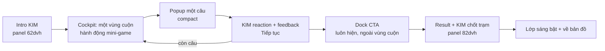

# 03 — Game Design

Tài liệu chốt vòng lặp trạm 2.0: cockpit một vùng cuộn, dock CTA luôn hiện, popup một câu compact, KIM phản hồi từng bước; 18 quyết định (nguồn: `src/game/content/index.ts`) và cách lồng pre-scan. Điểm/gói ở [04](04-scoring-offers.md); hình ảnh ở [06](06-storyboard.md); màn hình ở [05](05-user-flow.md).

> **Đồng bộ nội dung:** bảng quyết định dưới đây lược từ `PLANET_CONTENT` (18 quyết định: S 4, A 3, O 3, K 4, IM 4; 12 knowledge + 6 diagnosis). Nhãn đáp án trong bảng được rút gọn; chuỗi đầy đủ nằm trong code. Khi code đổi id/điểm/câu chữ, sửa tại đây trước khi release.

## 1. Mục tiêu thiết kế

1. **Người chơi ra quyết định trong lúc chơi.** Mini-game chạy hành động; tới điểm neo thì một **popup một câu** mở ra. Mỗi câu gắn với một hành động cụ thể, không có màn hỏi đáp riêng.
2. **Học bằng hậu quả.** Chọn xong thấy ngay một câu phản hồi nói điều gì xảy ra với thương hiệu, không phải "đúng/sai".
3. **Tiến bộ nhìn thấy được.** Mỗi trạm thắp một lớp sáng; bản đồ 5 trạm luôn hiển thị tiến độ.
4. **Không chặn.** Bỏ qua trạm, hết giờ, chọn 0 điểm đều đi tiếp được; vùng tối là thông tin, không phải hình phạt.
5. **Một ngón tay.** Chỉ tap/rê/kéo/giữ; mọi thao tác kéo có phương án tap.
6. **Một vùng cuộn, một CTA.** Trong trạm chỉ có một vùng nội dung cuộn; CTA chính nằm ở dock cố định đáy, không bao giờ bị nội dung đẩy khuất.

## 2. Intro 3D trước landing & vòng lặp trạm

### 2.1 Intro 3D (chỉ hiện lần đầu)

| Hạng mục | Chốt |
|---|---|
| Mục đích | Giới thiệu ẩn dụ "mỗi doanh nghiệp là một hành tinh đang ngủ" trước khi xin website; không dạy cách chơi |
| Thời lượng | 10 giây choreography: 5 nhịp ở 0 / 1,8 / 3,7 / 5,6 / 7,4 giây; **CTA hiện ở 8,8 giây**; mục tiêu cảm nhận khoảng 10 giây |
| Nội dung | Tít + lead 1 câu; 5 caption theo KIM (website → S → A → O·K·IM → bản đồ); rail 5 trạm S/A/O/K/IM sáng dần; hành tinh 3D sáng dần theo 5 lớp |
| Kết thúc | Không tự chuyển: người chơi bấm "Bắt đầu hành trình" hoặc "Bỏ qua"; cả hai đều về landing |
| Điều kiện hiện | Lần đầu mở, không có bản lưu resume, không có `?intro=0`; ép xem lại bằng `?intro=1` hoặc nút "Xem lại intro" ở header landing |
| Reduced motion / tier low | Vào thẳng nhịp cuối, CTA hiện ngay, không dolly/không animation |
| Không làm | Không bán hàng, không nhắc gói/giá, không thay gameplay hay thay landing; intro chỉ là lớp giới thiệu |

### 2.2 Vòng lặp mỗi trạm 90–120 giây

| Trạm | Trần thời lượng | Nhịp | Hành động chính | Số quyết định | Điều kiện hoàn thành |
|---|---|---|---|---|---|
| S | 90s | Intro 10s → quét 4 vùng 20–40s → 4 quyết định → outro 8s | Chạm/rê mở 4 ô sương, nội dung bị che tới khi mở | 4 | Mở đủ 4 vùng và trả lời 4 câu (dock đếm theo vùng rồi theo câu) |
| A | 100s | Intro 10s → nối 3 sao (icon) 15s → đặt logo + chốt sau 850ms → chọn 2 tính cách 15s → 3 quyết định → outro 8s | Nối 3 icon chòm sao, chọn horizon, đặt logo lên bản đồ 2 trục | 3 | Đủ 3 sao, horizon có giá trị (mặc định 3 năm), logo đã chốt, 2 tính cách |
| O | 110s | Intro 8s → tìm 2 mockup sai trong 15s → test màu 3s → 3 quyết định → outro 8s | Soi 6 mockup, ghi nhớ màu | 3 | Đã chọn 2 mockup (đúng hoặc hết 15s) + trả lời test màu |
| K | 120s | Intro 8s → xếp 5 card 20s → nạp/phóng 10s → khủng hoảng 30s → 4 quyết định → outro 8s | Sắp thứ tự, giữ nạp, chọn phản hồi khủng hoảng | 4 | 5 card đã xếp, tàu đã phóng, khủng hoảng có lựa chọn |
| IM | 100s | Intro 8s → tua 12 tháng → 4 sự kiện → outro 8s | Chọn cách xử lý 4 sự kiện theo mốc tháng | 4 | 4 sự kiện đã chọn |

Giữa hai trạm là **một chuyến bay 2,9 giây** (bỏ qua được), không quay về bản đồ. Chi tiết ở [05](05-user-flow.md) §4.6 và [06](06-storyboard.md) §4.

**Thời lượng là trần thiết kế**, không phải đồng hồ đếm ngược. Chỉ 2 chỗ có giới hạn thời gian thật: tìm mockup O (15 giây) và khủng hoảng K (30 giây). Mục tiêu trung vị toàn hành trình là **8 phút**; nếu đo thấy trung vị > 10 phút (event `planet_complete`), cắt intro/outro 2 giây mỗi trạm và giảm A/IM 15 giây trước khi cắt nội dung.

## 3. Pacing toàn hành trình

| Đoạn | Cảm xúc mục tiêu | Cường độ | Ghi chú |
|---|---|---|---|
| Landing → crawl | Tò mò | 2/5 | Hành tinh tối, radar quay |
| Confirm | Kiểm soát | 2/5 | Người chơi sửa được mọi thứ |
| Launch | Hưng phấn nhẹ | 3/5 | 3 giây, bỏ qua được |
| Chuyến bay | Nhịp chuyển, hồi hộp nhẹ | 2/5 | 2,9 giây; bỏ qua được; không chặn |
| S | Lắng lại, nhìn kỹ | 2/5 | Trạm chậm nhất, nhiều chữ nhất |
| A | Suy nghĩ, căng nhẹ | 3/5 | Mâu thuẫn định vị xuất hiện |
| O | Tập trung, áp lực thời gian | 4/5 | 15 giây tìm lỗi |
| K | Cao trào | 5/5 | Phóng tàu + khủng hoảng 30 giây |
| IM | Trầm, chiêm nghiệm | 3/5 | Tua tháng, thấy hậu quả tích luỹ |
| Finale | Được ghi nhận | 4/5 | Phần thưởng cảm xúc |
| Report | Rõ ràng, có việc để làm | 2/5 | Một trang, không quá tải |

Sau trạm căng (O, K), màn kết quả trạm và chuyến bay là điểm nghỉ: người chơi thấy lớp sáng vừa bật trước khi hạ cánh xuống trạm tiếp.

## 4. Cơ chế từng trạm

| Trạm | Cơ chế | Tương tác | Phương án tap | Dữ liệu trả về |
|---|---|---|---|---|
| S | 4 ô sương 2×2 (Nội tại, Thị trường, Đối thủ, Nhận diện) che nội dung thật: chữ mờ + blur, chỉ lộ khi mở; tín hiệu lấy từ pre-scan | Chạm mở 1 ô; rê đánh dấu nhiều ô rồi thả tay để mở | Chạm từng ô (không cần rê) | `onDecision` × 4 |
| A | 3 icon chòm sao (cờ Sứ mệnh, kính Tầm nhìn, đá Giá trị); chọn horizon 1/3/5 năm; kéo/chạm đặt logo lên bản đồ 2 trục, chốt sau 850ms; chọn 2/6 tính cách; phát hiện mâu thuẫn vị trí–tính cách | Chạm icon, chạm/kéo bản đồ | Chip horizon + 3 preset vị trí (chốt ngay) | `onDecision` × 3 |
| O | 6 mockup gắn logo thật; tìm 2 mockup sai màu/font trong 15 giây; test ghi nhớ màu chính 3 giây | Chạm mockup | Chạm (bản thân nó là tap) | `onDecision` × 3, `timeBonus` 0–1 |
| K | Xếp 5 card ra mắt bằng tap; giữ nạp 3 giây rồi phóng; khủng hoảng 30 giây với 4 lựa chọn phản hồi | Tap sắp card, giữ nạp | Tap card để đổi chỗ; nút "Phóng" thay cho giữ (sau 3s) | `onDecision` × 4, `crisisFast` |
| IM | Tua 12 tháng, 4 sự kiện (tháng 2, 5, 8, 11); đồng hồ "Độ nhất quán" 0–10 | Tap chọn cách xử lý | Tap | `onDecision` × 4, `meter` 0–10 |

### 4.1 Cockpit, panel và dock

Trạm 2.0 là một cockpit: hành tinh 3D phía trên, panel trạm phía dưới. Panel đổi chiều cao theo pha, dock CTA nằm ngoài vùng cuộn.

| Pha | Panel | Nội dung | CTA ở đâu |
|---|---|---|---|
| `intro` | `min(62dvh, 100dvh − 110px, 560px)` | KIM mặt lớn đang nói + 2 câu intro + chip trạm | Nút "Bắt đầu trạm" cuối panel |
| `playing` | `min(84dvh, 100dvh − 96px, 860px)`; máy thấp (< 700px) dùng 87dvh | Một vùng cuộn duy nhất (`kim-game__body`): HUD KIM 2 dòng + mini-game | **Dock cố định đáy**, 1 CTA, cao ≥ 50px, ngoài vùng cuộn |
| `result` | `min(82dvh, 100dvh − 104px, 820px)`; máy thấp dùng 86dvh | KIM chốt trạm, X/10, sao, huy hiệu, insight | Nút "Cất cánh đến {trạm kế}" / "Đến Sao Kim" cuối panel |

- Mobile và fold/duo dọc: panel đáy; **≥ 900px và cao ≥ 640px**: panel thành console nổi bên phải (rộng `min(420px, 40vw)`, tối thiểu 340px). Tablet/fold/duo ngang thấp (700–899px, cao < 640px) dùng console phải hẹp; rất thấp (< 560px) panel toàn màn hình.
- ≥ 1200px: console rộng `min(440px, 32vw)`, tối thiểu 388px và có nút thu gọn/mở lại.
- Dock hiện ở mọi pha chơi; nhãn đổi theo trạng thái ("Còn 4 vùng sương" → "Còn 4 câu hỏi" → "Hoàn tất trạm S"), nút chính `disabled` khi chưa đủ điều kiện. Không có CTA nào bị đẩy xuống dưới vùng cuộn. HUD có "Gợi ý" sau 25 giây và "Đi tiếp" sau 45 giây.
- Chỉ **một vùng cuộn** trong trạm; header HUD và dock đứng yên.

### 4.2 KIM phản hồi

KIM là mặt hologram SVG/CSS (4 mood: `idle`, `happy`, `thinking`, `curious`; miệng mở/khép khi nói) — không tạo WebGL.

| Thời điểm | Nội dung | Nguồn |
|---|---|---|
| Intro trạm | Mặt KIM lớn + 2 câu intro, KIM "đang nói" | `content.intro` |
| Sau mỗi câu | 1 câu reaction theo điểm: 2 → "Chuẩn hướng…", 1 → "Được một phần…", 0 → "Chưa khớp, nhưng…" | `kimReaction(points)` |
| Kết quả trạm | 1 câu theo 3 mức điểm (≥ 8 / ≥ 5 / < 5), có tên thương hiệu; bong bóng bỏ phần "Điểm trạm" để tránh lặp | `kimPlanetLine` |
| Trong popup | Mặt KIM nhỏ cạnh feedback sau khi chọn; tone quyết định mood | `QuestionFlow` |

- Bubble nói dùng typewriter 16–38ms/ký tự; `prefers-reduced-motion` → hiện đủ câu ngay.
- Screen reader đọc nguyên câu **một lần** qua live region; phần chạy chữ là `aria-hidden`.
- KIM không bán hàng, không nhắc tên gói, không dùng "sai/kém/thất bại".

## 5. 18 quyết định

> **Copy pass 11/2026:** prompt, nhãn đáp án, feedback và explain dưới đây chép nguyên văn từ `src/game/content/index.ts` (17/18 câu đổi; `k-one-line` giữ nguyên). Quy ước: 3 lựa chọn 2/1/0; cột "Hệ quả" là điều xảy ra với thương hiệu nếu chọn 0 — dùng cho báo cáo.

### Quy chuẩn copy (tự động kiểm bằng `tests/game/content-copy.test.ts`)

| Hạng mục | Quy chuẩn |
|---|---|
| Prompt | ≤ 85 ký tự, kết thúc bằng "?", không chứa "đúng nhất" |
| Nhãn đáp án | 20–120 ký tự; 3 ngoại lệ ngắn đã chốt nguyên văn: `s-customer-words-b`, `o-why-mismatch-c`, `o-color-memory-b` |
| Cân độ dài | Chênh lệch nhãn dài nhất và ngắn nhất trong cùng câu ≤ 55 ký tự |
| Template | Không còn ngoặc vuông `[...]` trong nhãn |
| SLA/benchmark | Không tự đặt trong copy game; chỉ dùng cơ chế, không hứa kết quả hay số liệu |

### 5.1 Trạm S — Tinh cầu Sương Mù (90 giây)

| ID · kind | Prompt | Đáp án 2 / 1 / 0 kèm feedback | Giải thích | Hệ quả |
|---|---|---|---|---|
| `s-team-one-line` · knowledge | Ba người trong đội cùng giới thiệu công ty. Họ nên nói thế nào? | **2** "Cùng một câu: giúp ai, đạt kết quả gì, bằng cách riêng nào." → *Đúng. Khi cả đội nói cùng một câu, khách nghe thấy sự chắc chắn thay vì nhiều phiên bản.* / **1** "Mỗi người nói theo cách hiểu của mình, miễn khách hiểu." → *Khách hiểu, nhưng mỗi người đang bán một phiên bản hơi khác nhau của bạn.* / **0** "Uy tín, chất lượng, giá tốt — câu nào cũng dùng được." → *Ba cụm từ mà đối thủ nào cũng dùng. Khách không có gì để nhớ hay để kể lại.* | Một câu định vị không phải khẩu hiệu treo tường. Nó là bộ lọc: giúp cả đội biết việc nào đúng, việc nào nên từ chối. | Khách không có gì để nhớ; so sánh bằng giá |
| `s-customer-words` · knowledge | Khi khách giới thiệu bạn với đồng nghiệp, họ thường nói câu nào? | **2** "Một câu cụ thể về việc bạn giúp họ, họ có thể lặp lại." → *Tốt. Lặp lại nhất quán là cách duy nhất để một câu đi vào trí nhớ người khác.* / **1** "Tên công ty và giá." → *Được. Nhưng khi chỉ còn tên và giá, khách sẽ so sánh bằng giá.* / **0** "Một lời khen chung chung: “cũng được”." → *Lời khen chung chung là dấu hiệu thương hiệu chưa để lại dấu vết.* | Khách không cần hiểu chiến lược của bạn. Họ chỉ cần có sẵn một câu để kể lại. Nếu bạn không đưa, họ sẽ tự ghép từ giá và cảm giác. | Truyền miệng yếu, khách mới đến vì giá |
| `s-premium-reason` · knowledge | Khách hỏi vì sao bạn đắt hơn. Câu trả lời nào đứng vững? | **2** "Một lợi ích cụ thể chỉ mình làm được, kèm bằng chứng." → *Đúng. Khách trả thêm cho một lợi ích họ tin, không trả thêm cho lời khen chính mình.* / **1** "Chất lượng hơn, dịch vụ tốt hơn." → *Nghe hợp lý nhưng đối thủ rẻ hơn cũng nói y vậy.* / **0** "Giảm giá để giữ khách lần này." → *Một lần giảm giá dạy khách chờ lần giảm giá tiếp theo.* | Giá cao chỉ đứng được khi khác biệt rõ và nhìn thấy được. Nếu khác biệt chỉ nằm trong cảm nhận của bạn, khách sẽ chọn nơi rẻ hơn. | Biên lợi nhuận giảm; khách chờ giảm giá |
| `s-slogan-reality` · diagnosis (evidenceKey: `slogan`) | Website có một câu nêu rõ bạn khác biệt ở đâu không? | **2** "Có, ở ngay màn hình đầu và lặp lại ở các trang chính." → *Tốt. Khách chỉ cần vài giây đầu để biết đây có phải chỗ dành cho mình.* / **1** "Có, nhưng bị chôn sâu hoặc mỗi trang nói một kiểu." → *Câu đúng đang bị giấu. Mỗi trang nói một kiểu thì câu nào cũng yếu.* / **0** "Chưa có; chỉ có tên và mô tả chung." → *Website đang đứng tên bạn nhưng chưa nói hộ bạn.* | Đây là câu tự soi, không phải để trách. Nếu website chưa có câu định vị, mọi kênh khác cũng đang thiếu điểm tựa. | Website không giữ được khách trong 5 giây đầu |

### 5.2 Trạm A — Đài Thiên Văn (100 giây)

| ID · kind | Prompt | Đáp án 2 / 1 / 0 kèm feedback | Giải thích | Hệ quả |
|---|---|---|---|---|
| `a-mission` · knowledge | Câu nào nói đúng lý do công ty bạn tồn tại? | **2** "Giúp một nhóm khách cụ thể giải quyết vấn đề theo cách riêng, để họ đạt kết quả." → *Đúng. Sứ mệnh phải chỉ được việc làm hằng ngày, không chỉ để in trên tường.* / **1** "Trở thành công ty số một Việt Nam." → *Đó là mục tiêu, không phải lý do tồn tại. Khách không thấy mình trong đó.* / **0** "Tối đa hóa lợi nhuận cho cổ đông." → *Khách không mua vì lợi nhuận của bạn. Đây là mục tiêu tài chính, không phải sứ mệnh.* | Sứ mệnh đúng khi một nhân viên mới đọc xong biết mình nên làm gì và nên từ chối gì. | Đội không có tiêu chí chọn việc; mọi cơ hội đều thành dự án |
| `a-values` · knowledge | Điều gì bạn sẵn sàng từ chối một hợp đồng để giữ? | **2** "Một nguyên tắc cụ thể, ví dụ: không nói sai về sản phẩm để có đơn." → *Đúng. Giá trị phải nhìn thấy được trong một quyết định, không chỉ trong một tính từ.* / **1** "Nhiệt tình, trung thực, chuyên nghiệp." → *Đúng nhưng ai cũng nói. Chưa đủ để hướng dẫn một quyết định khó.* / **0** "Không có điều nào đủ rõ để từ chối." → *Nếu không có gì để từ chối, mọi khách hàng đều có thể kéo thương hiệu đi theo hướng khác.* | Giá trị không phải lời hứa với khách. Đó là luật chơi nội bộ để đội biết khi nào phải dừng. | Thương hiệu bị kéo theo từng hợp đồng; đội mất phương hướng |
| `a-logo-premium` · diagnosis (evidenceKey: `logo`) | Nhìn logo vừa đặt: nó có khớp với mức định vị bạn chọn không? | **2** "Khớp: logo, màu và kiểu chữ cùng nói một mức." → *Tốt. Nhận diện và định vị đang đồng thanh, không đánh nhau.* / **1** "Khớp một phần: logo đúng nhưng cách dùng còn lẫn mức khác." → *Khách nhận ra sự lẫn lộn dù không gọi tên được. Hãy thống nhất cách dùng trước khi mở rộng.* / **0** "Chưa khớp: logo giống một thương hiệu ở mức khác." → *Định vị là một chuyện, nhìn vào lại là chuyện khác. Khách tin mắt họ hơn tin lời bạn.* | Đây là câu tự soi: bạn vừa kiểm tra xem hình ảnh có khớp với vị trí trên bản đồ không. Không có đáp án nào bị trừ oan. | Định vị một đằng, hình ảnh một nẻo; khách chọn theo cảm nhận |

### 5.3 Trạm O — Xưởng Chế Tác (110 giây)

| ID · kind | Prompt | Đáp án 2 / 1 / 0 kèm feedback | Giải thích | Hệ quả |
|---|---|---|---|---|
| `o-why-mismatch` · knowledge | Hai mockup lệch màu và font. Nguyên nhân gốc là gì? | **2** "Thiếu bộ quy định màu, font và khoảng cách cho từng chất liệu." → *Đúng. Khi thiếu quy chuẩn, mỗi nhà in và mỗi người thiết kế tự quyết.* / **1** "File logo chưa đủ nét." → *Có thể, nhưng file nét hơn không sửa được một màu bị in sai.* / **0** "Nhà in làm ẩu." → *Đổ lỗi cho nhà in không giúp lần sau khác đi. Họ chỉ làm theo thứ được gửi.* | Hệ thống nhận diện không chỉ là logo. Nó là bộ luật cho màu, font, khoảng cách và cách dùng trên mọi chất liệu. | Mỗi lần in là một phiên bản thương hiệu; chi phí sửa lặp lại |
| `o-color-memory` · knowledge | Vì sao màu thương hiệu thường được nhận ra trước tên và logo? | **2** "Màu được xử lý trước khi đọc chữ và lặp lại ở mọi nơi khách gặp." → *Đúng. Màu là tín hiệu nhanh nhất, nhưng chỉ mạnh khi dùng giống nhau ở mọi nơi.* / **1** "Vì màu sáng hơn." → *Độ sáng chỉ giúp thấy trước. Điều giữ màu trong trí nhớ là sự lặp lại nhất quán.* / **0** "Vì màu là chi tiết quan trọng nhất." → *Màu quan trọng, nhưng nếu mỗi nơi một sắc thì khách nhớ một mớ màu, không nhớ thương hiệu.* | Trí nhớ thị giác cần điểm neo. Màu là điểm neo rẻ nhất, nhanh nhất — với điều kiện nó không đổi. | Nhận biết không tích luỹ; quảng cáo phải dạy lại từ đầu |
| `o-guideline-reality` · diagnosis (evidenceKey: `color`) | Bạn đã có bản quy định nhận diện chính thức (màu, font, cách đặt logo) chưa? | **2** "Có, bản chính thức và cả đội dùng chung." → *Tốt. Có bản chung nghĩa là tranh cãi về sau ít hơn.* / **1** "Có, nhưng chỉ một người giữ hoặc bản đã cũ." → *Tri thức nằm trong một người là rủi ro. Người đó nghỉ việc, quy chuẩn đi theo.* / **0** "Chưa có; mỗi người tự xử lý." → *Chưa có quy chuẩn là lý do hai mockup kia lệch nhau ngay trước mắt bạn.* | Đây là câu tự soi để dung hoà giữa điều bạn vừa học và điều đang có. Không phải bài kiểm tra để phán xét. | Chất lượng điểm chạm phụ thuộc người làm, không phụ thuộc hệ thống |

### 5.4 Trạm K — Bệ Phóng (120 giây)

| ID · kind | Prompt | Đáp án 2 / 1 / 0 kèm feedback | Giải thích | Hệ quả |
|---|---|---|---|---|
| `k-order` · knowledge | Trước khi ra mắt, việc nào phải xong đầu tiên? | **2** "Một thông điệp duy nhất và kịch bản để cả đội nói giống nhau." → *Đúng. Ra mắt là lúc cả đội cùng nói một câu, không phải cùng đăng nhiều câu.* / **1** "Bộ ảnh và video thật đẹp." → *Đẹp giúp lần đầu được chú ý, nhưng không giữ được nếu thông điệp mỗi người một kiểu.* / **0** "Ngân sách chạy quảng cáo." → *Tiền chạy quảng cáo khuếch đại điều đang có. Nếu thông điệp còn mơ hồ, nó khuếch đại sự mơ hồ.* | Thứ tự đúng là: mục tiêu và thông điệp, nội dung, kích hoạt nội bộ, ra mắt, đo lường. Sai thứ tự thì mỗi bước sau đều phải làm lại. | Ngân sách ra mắt bị đốt cho nhiều thông điệp không nhớ được |
| `k-one-line` · knowledge | Trên màn hình ra mắt, một câu duy nhất nên nói gì? | **2** "Một lợi ích khách nhận được, nói bằng lời khách." → *Đúng. Một câu đúng khách có thể nhắc lại ngay khi rời màn hình.* / **1** "Tên công ty và năm thành lập." → *Khách cần biết bạn là ai, nhưng tên và tuổi không phải lý do để nhớ.* / **0** "Tất cả ưu đãi trong tháng." → *Ưu đãi thu hút người săn giá. Họ đến vì giá và đi khi giá hết.* | Ra mắt không phải lúc kể hết. Đó là lúc chọn đúng một điều khách phải nhớ. | Khách nhớ ưu đãi, không nhớ thương hiệu |
| `k-spokesperson` · diagnosis (evidenceKey: `social`) | Nếu bình luận xấu xuất hiện, ai sẽ nói thay bạn? | **2** "Một người có thẩm quyền, đã tập nói trước." → *Tốt. Khủng hoảng không chờ bạn tìm người. Có người sẵn là có bước đầu.* / **1** "Người rảnh nhất lúc đó." → *Có thể xoay được, nhưng một câu trả lời vội dễ tạo thêm một cuộc khủng hoảng.* / **0** "Chưa ai; mỗi người tự trả lời." → *Nhiều giọng nói trong khủng hoảng nghe như đang cãi nhau, không phải đang giải thích.* | Câu tự soi này dùng kênh mạng xã hội làm bằng chứng: nơi công khai đã có, thì người chịu trách nhiệm công khai phải có trước. | Khủng hoảng kéo dài vì không có tiếng nói chính thức |
| `k-debrief` · knowledge | Sau khủng hoảng, việc nào giúp lần sau xử lý tốt hơn? | **2** "Ghi lại kịch bản, người phát ngôn và bằng chứng đã dùng." → *Đúng. Một lần xử lý tốt chỉ là may mắn cho tới khi nó thành quy trình.* / **1** "Họp nhắc nhau rút kinh nghiệm." → *Ký ức sẽ phai. Không có bản ghi, bài học đi cùng người rời đi.* / **0** "Bỏ qua vì chuyện hiếm khi lặp lại." → *Khủng hoảng hiếm khi lặp y hệt, nhưng dạng chuyện thì lặp hoài.* | Mỗi khủng hoảng là một lần tập. Ghi lại để lần sau đội không phải học lại từ đầu. | Cùng một lỗi lặp lại với người mới |

### 5.5 Trạm IM — Trạm Vận Hành (100 giây)

| ID · kind | Prompt | Đáp án 2 / 1 / 0 kèm feedback | Giải thích | Hệ quả |
|---|---|---|---|---|
| `im-new-hire` · knowledge | Nhân viên mới đăng bài với logo cũ. Bạn xử lý thế nào? | **2** "Gửi lại file đúng kèm quy tắc để bạn ấy tự kiểm tra." → *Đúng. Sửa nhanh và sửa dễ hiểu giúp lần sau bạn ấy tự kiểm tra được.* / **1** "Nhắn riêng để bạn ấy tự sửa." → *Giữ được thể diện, nhưng nếu thiếu file và quy tắc, lần sau sẽ lặp lại.* / **0** "Bỏ qua, không ai để ý đâu." → *Một bài lệch nhỏ không sao. Một năm nhiều bài lệch nhỏ tạo thành một thương hiệu khác.* | Nhất quán được giữ bằng những lần sửa nhỏ, lặp đi lặp lại. Không phải bằng một buổi họp lớn. | Logo cũ sống song song với logo mới; khách thấy hai thương hiệu |
| `im-dealer` · diagnosis | Đại lý in biển hiệu lệch màu. Bạn đã chuẩn bị gì cho họ? | **2** "Bộ file chuẩn, hướng dẫn màu/font và quy trình duyệt mẫu." → *Tốt. Đại lý cần một bộ vật liệu dễ dùng, không chỉ một logo.* / **1** "File logo trong thư mục chung." → *Có file là bước đầu, nhưng thiếu hướng dẫn màu và font thì vẫn lệch.* / **0** "Chưa có gì; đại lý tự làm." → *Không có gì để theo, nên mỗi đại lý tạo một phiên bản thương hiệu riêng.* | Câu tự soi này không có tiêu chí website tương ứng, nên không bị trừ điểm vì bằng chứng bên ngoài. | Mạng lưới phân phối làm loãng nhận diện |
| `im-freelancer` · knowledge | Freelancer mới thiết kế theo gu riêng. Bạn chọn cách nào? | **2** "Đưa quy định ngắn kèm mẫu đã duyệt; duyệt bài trước khi đăng." → *Đúng. Freelancer làm tốt hơn khi biết giới hạn, không phải khi được thả tự do hoàn toàn.* / **1** "Góp ý trực tiếp từng bài." → *Bạn đang làm việc của một quy chuẩn bằng miệng. Sớm muộn cũng quá tải.* / **0** "Để họ sáng tạo tự do cho đỡ tốn thời gian." → *Tự do sáng tạo trong khuôn khổ là tốt. Tự do không khuôn khổ tạo ra thương hiệu thứ hai.* | Người ngoài không biết luật của bạn. Đưa luật ngắn, rõ, kèm ví dụ đúng là cách nhân bản sự nhất quán. | Chất lượng phụ thuộc người làm; chi phí sửa tăng |
| `im-scale` · diagnosis | Mở chi nhánh mới. Bạn giữ thương hiệu nhất quán bằng cách nào? | **2** "Chỉ định một người phụ trách nhận diện, đào tạo và bộ mẫu cho chi nhánh." → *Tốt. Mở rộng bền vững là mở rộng hệ thống, không chỉ mở thêm địa điểm.* / **1** "Gửi bộ file rồi tin tưởng." → *Thiện chí không thay được hướng dẫn. Người mới sẽ tự đoán những chỗ bạn cho là hiển nhiên.* / **0** "Mỗi chi nhánh tự làm theo cách hiểu của mình." → *Đó là cách một thương hiệu trở thành nhiều thương hiệu nhỏ, cùng tên.* | Câu tự soi về hệ thống vận hành. Không có tiêu chí website tương ứng, nên không bị trừ điểm. | Mỗi chi nhánh một bản sắc; khách nhận diện sai |

## 6. Pre-scan lồng vào trạm S

Pre-scan không tạo điểm; nó tạo **chất liệu** cho trạm S và bằng chứng cho báo cáo.

| Tiêu chí pre-scan | Vùng sương | Tín hiệu hiển thị khi mở vùng | Câu hỏi đi kèm |
|---|---|---|---|
| `logo` | Nhận diện | "Logo tìm thấy: {nguồn}, {kích thước}" hoặc "Không tìm thấy logo dùng được" | — (A dùng `logo` cho `a-logo-premium`) |
| `color` | Nhận diện / Nội tại | "Màu chủ đạo: {hex}, tương phản trên nền tối: {đạt/chưa}" | — |
| `slogan` | Thị trường | "Câu định vị: {trích đoạn}" hoặc "Chưa có câu nào nói bạn khác ở đâu" | `s-slogan-reality` |
| `social` | Đối thủ / Thị trường | "Kênh social: {n} kênh được liên kết" | — |
| `mobile` | Thị trường | "Website {có/không} tối ưu cho điện thoại" | — |

Nếu pre-scan không đủ tín hiệu (crawl lỗi/nhập tay), trạm S dùng **bộ 4 tín hiệu định kỳ** viết sẵn trong content mini-game; không hiển thị "không có dữ liệu" trước mặt người chơi.

Reality check: diagnosis chọn 2 điểm nhưng tiêu chí tương ứng < 6 → trừ 1 điểm diagnosis (tối đa 2). Áp dụng cho `s-slogan-reality` (slogan), `a-logo-premium` (logo), `o-guideline-reality` (color), `k-spokesperson` (social); **IM không áp dụng** vì 2 diagnosis không có `evidenceKey`. Chi tiết ở [04](04-scoring-offers.md) §3.

## 7. Huy hiệu & "Bạn có biết"

Huy hiệu bật khi điểm trạm ≥ 6; hiện ở outro và trong báo cáo (sáng/tối).

| Trạm | Badge ID | Tên | Blurb | Insight "Bạn có biết…" |
|---|---|---|---|---|
| S | `badge-scan` | Người Quét Sương | Bạn nhìn thấy tín hiệu trước khi nó thành vấn đề. | Khách thường không nhớ tên công ty, nhưng nhớ cảm giác khi được hiểu đúng. Một câu định vị rõ giúp cả đội nói cùng một điều. |
| A | `badge-align` | Người Đặt Trục | Bạn chọn được một hướng và dám để thứ khác ở lại. | Thương hiệu mạnh thường từ chối được những khách không thuộc về mình. Từ chối đúng giúp lời hứa còn nguyên vẹn. |
| O | `badge-craft` | Người Giữ Bề Mặt | Bạn biết nhận diện không nằm gọn trong logo. | Bộ não nhận ra màu trước khi đọc chữ. Vì vậy một màu sai trên tấm biển có thể làm khách ngờ ngợ dù logo vẫn đúng. |
| K | `badge-launch` | Người Cất Tiếng | Bạn ra mắt bằng kịch bản, không bằng may mắn. | Trong khủng hoảng, sự im lặng cũng là một câu trả lời — và thường là câu trả lời khách nghe thấy rõ nhất. |
| IM | `badge-keep` | Người Giữ Lửa | Bạn biến thương hiệu thành thói quen của cả đội. | Người ta giữ được thói quen tốt khi có luật ngắn, dễ làm và có người nhắc. Thương hiệu nhất quán cũng vậy. |

Insight của trạm mở đầu bằng "Bạn có biết…", không có số liệu bịa, không nhắc tên gói. Insight hiển thị ở màn hình chuyển tiếp sau outro.

## 8. Hợp đồng host ↔ mini-game

Theo `PlanetGameProps` (`src/shared/game.ts`):

- `onDecision({ decisionId, optionId, kind, points, ms })` gọi mỗi lần chốt; `ms` là thời gian từ lúc câu hỏi hiện đến lúc chọn (dùng cho phân tích, không dùng cho điểm).
- `onComplete({ meter?, timeBonus?, crisisFast?, skipped? })` gọi khi trạm kết thúc; host chấm bằng `scorePlanet`.
- `onGuide(text)` để KIM nói câu ngắn trong khung hướng dẫn. Khi chốt đáp án, `feedback` hiển thị trong popup (không lặp lại nguyên câu dài ở thanh KIM); `explain` mở ngay dưới phản hồi.
- `skipped: true` khi người chơi bỏ qua trạm → điểm trạm 0, hiện vùng tối, không chặn.

| Trạm | Payload | Quy tắc tính | Ảnh hưởng điểm |
|---|---|---|---|
| S | `{}` | Không bonus | — |
| A | `{}` | Không bonus | — |
| O | `timeBonus 0–1` | `0,7 × (thời gian còn lại / 15s)` nếu tìm đủ 2 mockup trong cửa sổ + `0,3` nếu nhớ đúng màu chính; trượt/không đủ 2 mockup → phần thời gian = 0 | Cộng vào tổng điểm thô knowledge trước khi chuẩn hoá, tối đa +1 |
| K | `crisisFast: true` | Chọn phản hồi khủng hoảng < 10.000ms kể từ lúc mở bình luận | +0,5 vào điểm trạm K sau khi tính tỉ lệ |
| IM | `meter 0–10` | `10 − 0,1 × số giây sự kiện chưa trả lời − chi phí lựa chọn` (2→0; 1→0,8; 0→2), clamp 0–10, 1 số lẻ; phải chọn đủ 4 sự kiện | 20/100 trọng số trạm: `0,5K + 0,3D + 0,2M` |

## 9. Quy tắc trải nghiệm

**Popup một câu, gắn với hành động.** Mini-game đang chạy hành động (quét sương, nối sao, tìm mockup, xếp card, tua tháng); tới điểm neo, `QuestionFlow` mở **một popup một câu** phía trên. Mỗi câu hỏi gắn với một hành động cụ thể thay vì một màn hỏi đáp riêng. Trả lời xong, popup hiện phản hồi + "Tiếp tục", rồi người chơi tiếp tục phần còn lại của trạm.

| Trạm | Hành động | Điểm neo (mount) | Quyết định phủ |
|---|---|---|---|
| S | Mở 4 vùng sương | 1 neo trong vòng lặp vùng đã mở (render tối đa 4 lần) | 4 |
| A | Nối sao → đặt logo | 2 neo (chòm sao đổi câu theo sao đang nối; sau khi đặt logo) | 3 |
| O | Tìm mockup → test màu | 3 neo (sau tìm, sau test màu, trước hoàn tất) | 3 |
| K | Xếp card → nạp → khủng hoảng | 4 neo (sau xếp card, trước nạp, trước bình luận, sau debrief) | 4 |
| IM | Tua 12 tháng | 1 neo tái sử dụng theo 4 mốc tháng | 4 |
| **Tổng** | | **11 điểm mount** | **18** |

**Cơ chế popup.**

| Hành vi | Chốt |
|---|---|
| Mở | Một popup tại một thời điểm; hàng đợi FIFO theo thứ tự đăng ký của neo |
| Ẩn | Nút Ẩn, nút X, Escape hoặc chạm nền → thu thành pill "Câu hỏi X/N đang chờ" ở đầu khung game; chạm pill mở lại |
| Trả lời | Chọn 1 trong 3 đáp án → 3 đáp án thu gọn thành một dòng "đáp án đã chọn" (chữ cái + nhãn + tone); bên dưới là feedback có mặt KIM + explain; đáp án khoá |
| Đi tiếp | Footer popup dính đáy: trước khi chọn hiện "Chọn một đáp án", sau khi chọn hiện nút "Tiếp tục"; đóng popup và mở câu kế trong hàng đợi |
| Cuộn | Nền game khoá cuộn (`body overflow: hidden`). Popup 1 câu + 3 đáp án vừa màn hình chuẩn, không phải cuộn; chỉ thân popup cuộn khi máy quá thấp. Sau khi chọn, nội dung tự đưa feedback lên đầu |
| Đồng hồ | Khi popup mở hoặc đang ẩn chờ, mini-game coi như `paused`: IM dừng trừ "Độ nhất quán" |
| Đo thời gian | `ms` chỉ bắt đầu từ lần đầu popup thực sự hiện câu đó (`onShown`) |
| Desktop | ≥ 900px: modal giữa màn hình; dưới 900px: bottom sheet |
| Test ID | `question-modal`, `question-pill`, `question-hide`, `question-continue`, `question-option-{optionId}`, `question-chosen`, `question-feedback`, `game-dock`, `scan-grid`, `fog-zone-{n}` |
| A11y | `role="dialog"`, `aria-modal`, focus trap, Esc về pill, `aria-live="polite"` cho phản hồi |

**Thất bại không chặn.** Chọn 0 điểm: KIM phản hồi 1 câu, đi tiếp; không hiện "sai", không trừ mạng, không bắt làm lại. Hết 15 giây ở O: vẫn chọn tiếp không giới hạn để hoàn thành. Hết 30 giây ở K: ghi nhận lựa chọn đang trỏ, `crisisFast = false`. Không hoàn thành trạm: HUD hiện "Gợi ý" sau 25 giây và "Đi tiếp" sau 45 giây; "Bỏ qua trạm này" luôn có trong pause sheet. Bỏ qua đặt trạm 0/10, hiện vùng tối, không chặn hành trình — chỉ xem lại được trong báo cáo.

**Timer.** Chỉ 2 timer thật (O 15s, K 30s). Timer dừng khi tab ẩn (`visibilitychange`), tiếp tục khi quay lại; hiển thị số giây còn lại dạng vòng cung, không nhấp nháy đỏ, không có âm thanh đếm ngược. Không có đồng hồ tổng.

**Accessibility.**

| Hạng mục | Yêu cầu |
|---|---|
| Tap target | ≥ 44×44px, cách nhau ≥ 8px |
| Chữ | ≥ 16px body; tiêu đề 20–24px; không dùng chữ mảnh < 400 |
| Tương phản | ≥ 4,5:1 cho chữ thường; ≥ 3:1 cho chữ lớn và viền |
| Màu | Không dùng màu làm tín hiệu duy nhất; luôn kèm nhãn/icon |
| Screen reader | Mỗi lựa chọn có `aria-label` đầy đủ; thông báo kết quả qua `aria-live="polite"` |
| Bàn phím | Mọi nút focus được; thứ tự tab hợp lý; Esc đóng sheet |
| Reduced motion | Tắt parallax/camera shake; chuyển cảnh fade 200ms |
| Âm thanh | Không bắt buộc để hiểu; có phụ đề cho mọi câu KIM nói |
| Chữ dài | Tên thương hiệu dài ≤ 120 ký tự; wrap tối đa 2 dòng, ellipsis |
| Xoay ngang | Không bắt buộc; layout dọc, cảnh báo nhẹ nếu ngang |

## 10. Test ID & QA nội dung

Test ID ổn định (dùng cho Playwright): `planet-game`, `planet-host`, `planet-intro`, `game-dock`, `question-modal`, `question-pill`, `question-hide`, `question-continue`, `question-option-{optionId}`, `question-chosen`, `question-feedback`, `scan-grid`, `fog-zone-{n}`, `align-map`, `star-{n}`, `vision-{n}`, `pause-button`, `pause-sheet`, `continue`, `badge`, `meter`, `crisis-timer`, `mockup-{n}`, `kim-companion`, `kim-speech`.

QA nội dung tự động (`tests/game`): mỗi quyết định đúng 3 option, đúng 1 option 2 điểm, `feedback`/`explain` không rỗng, không chứa ký hiệu phần trăm, không chứa tên gói (`Brand audit`, `Marcom`, `guideline`…), không chứa số liệu dạng "x phần trăm", `evidenceKey` chỉ ở diagnosis và đúng bảng S/A/O/K, IM không có `evidenceKey`, option id = `decisionId-a|b|c`.

## 11. Liên kết

- Điểm chi tiết, reality check, map gói: [04](04-scoring-offers.md).
- Luồng màn hình: [05](05-user-flow.md).
- Hình ảnh từng khoảnh khắc: [06](06-storyboard.md).
- Ma trận test thiết bị: [09](09-mobile-qa.md).
