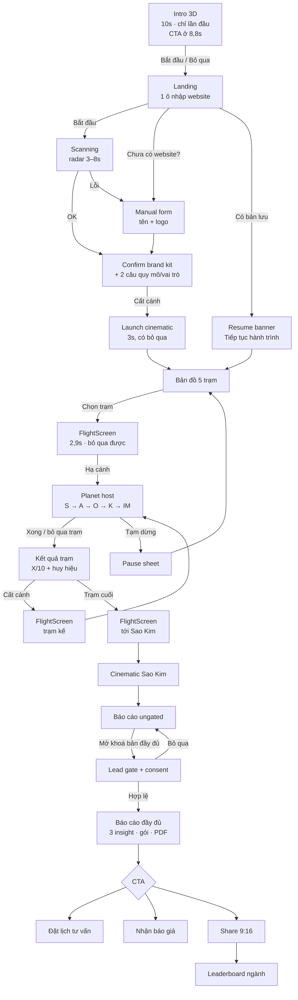
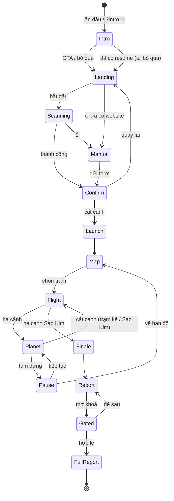

# 05 — User Flow

Tài liệu chốt đường đi từ lần chạm đầu tiên đến CTA cuối, danh sách màn hình, copy chính và mọi trạng thái ngoại lệ. Game design ở [03](03-game-design.md); hình ảnh ở [06](06-storyboard.md); tiêu chí thiết bị ở [09](09-mobile-qa.md).

## 1. Nguyên tắc

1. **Ba lần chạm tới trò chơi:** landing → nhập website → bắt đầu. Không đăng ký, không tài khoản.
2. **Không chặn lead từ đầu.** Báo cáo ungated trước, form chỉ xuất hiện khi người chơi muốn xem bản đầy đủ.
3. **Không mất tiến độ.** Mọi trạm lưu sau mỗi quyết định; resume trong 7 ngày; mất mạng vẫn chơi tiếp được và đồng bộ sau.
4. **Một ngón tay.** Không joystick, không vuốt hai ngón, không xoay ngang bắt buộc.
5. **Mỗi lỗi có đường ra.** Không có màn hình chết; lỗi crawl → nhập tay; lỗi WebGL → 2.5D; lỗi PDF → gửi email sau.
6. **Không dùng ký hiệu phần trăm.** Progression dùng "2/5 trạm", "7/10", số sao.
7. **Chuyến bay thay bản đồ.** Mỗi lần chuyển trạm là một chuyến bay 2,9 giây (bỏ qua được); bản đồ chỉ mở khi người chơi chủ động tạm dừng.
8. **Intro chỉ lần đầu.** Lần mở đầu tiên có intro 10 giây trước landing; người có bản lưu hoặc đã xem thì vào thẳng landing. Bỏ qua được, không bán hàng.

## 2. Sơ đồ tổng

## 3. Screen inventory

| # | Screen | Điều kiện vào | Mục đích | Hành động chính | 3D mode | Thời gian mục tiêu |
|---|---|---|---|---|---|---|
| 1 | `intro` | Lần đầu mở, không có resume, không `?intro=0` | Giới thiệu ẩn dụ 5 trạm trước khi xin website | Xem hoặc "Bỏ qua"; CTA "Bắt đầu hành trình" | `intro` (5 lớp sáng dần) | 10s; CTA ở 8,8s |
| 2 | `landing` | Mở `/` | Lấy URL, tạo niềm tin | Nhập website + "Bắt đầu" | `landing` (hành tinh ngủ + sao) | 10–20s |
| 3 | `scanning` | Bấm bắt đầu | Giữ người chơi trong lúc chờ | Xem radar/checklist, "Nhập tay" | `landing` | 3–8s |
| 4 | `confirm` | Có `ScanResult` | Xác nhận brand kit + hồ sơ | Sửa logo/tên/màu, chọn 2 câu | `landing` zoom vào hành tinh | 20–40s |
| 5 | `launch` | Bấm "Cất cánh" | Chuyển trạng thái, tạo hype | Xem hoặc bỏ qua | `launch` | 3s |
| 6 | `flight` | Chọn trạm ở map / cất cánh từ kết quả trạm | Chuyển cảnh giữa hai trạm | Xem hoặc "Bỏ qua chuyến bay" | `flight` | 2,9s (0,65s nếu reduced motion) |
| 7 | `map` | Xong launch / từ pause sheet | Chọn trạm tiếp, thấy tiến bộ | Chạm trạm kế | `planet` (orbit) | 3–8s/trạm |
| 8 | `planet` | Chạm trạm | Cockpit: intro → mini-game + popup → result | Tap/rê/kéo/giữ; dock CTA | `planet` | 90–120s/trạm |
| 9 | `finale` | Đủ 5 trạm | Phần thưởng cảm xúc | Xem, "Xem báo cáo" | `finale` | 8–12s + skip |
| 10 | `report` | Xong finale | Trả kết quả ungated | Cuộn, mở khoá, share | `finale` (poster) | 40–90s |
| 11 | gate (trong `report`) | Bấm "Mở khoá bản đầy đủ" | Thu lead có consent | Điền tên + SĐT/email | poster | 30–60s |
| 12 | full report (trong `report`) | Lead hợp lệ | Chuyển giao giá trị | Đọc insight, xem gói, tải PDF, đặt lịch | poster | 60–180s |
| 13 | share/leaderboard | Từ CTA | Lan truyền, so sánh | Tải ảnh 9:16, xem bảng | poster | 20–60s |

Ngoài ra: `privacy` (sheet, mở từ landing/report/gate), `install` (PWA prompt không tự bật), `error` (sheet lỗi toàn cục).

## 4. Chi tiết từng màn

### 4.0 Intro

- Điều kiện hiện: lần đầu mở máy, chưa có bản lưu resume, không có `?intro=0`. Người đã có tiến trình không bị chặn; `?intro=1` ép xem lại; nút "Xem lại intro" ở header landing mở lại (event `intro_replay`).
- Khung: hành tinh 3D thức dậy theo 5 lớp sáng; rail 5 trạm S/A/O/K/IM sáng dần; KIM caption 5 nhịp; camera dolly chậm 10 giây.
- Nhịp: 0 → 1,8 → 3,7 → 5,6 → 7,4 giây cho 5 caption; **CTA hiện ở 8,8 giây**. Không tự chuyển: người chơi bấm "Bắt đầu hành trình" hoặc "Bỏ qua".
- Sau khi xem: ghi `saokim:intro:v1` vào localStorage, xoá `?intro` khỏi URL; các lần sau vào thẳng landing.
- Reduced motion hoặc tier low: vào nhịp cuối + CTA ngay, không dolly/animation.
- Không bán hàng, không nhắc gói/giá; đây là lớp giới thiệu, không phải gameplay.

### 4.1 Landing

- Khung: nền sao navy, hành tinh tối ở giữa dưới, logo Sao Kim góc trên trái, nút âm thanh góc trên phải (mặc định bật, lần chạm đầu mở khoá).
- Tiêu đề: **"Thương hiệu của bạn đang sáng ở đâu?"**
- Phụ: "Nhập website. 8 phút. Nhận bản đồ thương hiệu của riêng bạn."
- Ô nhập: placeholder `saokim.vn`; bàn phím `type="url"`, `inputmode="url"`, không tự động focus trên mobile (tránh bàn phím che).
- Nút chính: **"Bắt đầu hành trình"**; nút phụ: "Chưa có website?" → form nhập tay.
- Dòng tin cậy: "Không cần đăng ký · Không bán dữ liệu của bạn · Thông báo dữ liệu" (mở privacy sheet, không phải link ngoài).
- Banner resume nếu có bản lưu < 7 ngày: "Bạn còn dang dở ở trạm O — Tiếp tục / Bắt đầu mới".
- Lỗi input: URL không hợp lệ → viền đỏ + "Mình cần một địa chỉ website, ví dụ saokim.vn"; trống → "Nhập website để mình bắt đầu nhé".

### 4.2 Scanning

- Radar tròn quay chậm + 4 dòng checklist hiện dần: "Đọc trang chủ" → "Tìm logo" → "Lấy bảng màu" → "Kiểm tra 5 tín hiệu".
- Không hiển thị thời gian đếm ngược (tránh áp lực); sau 8s hiện "Vẫn đang đọc — bạn có thể nhập tay".
- Nút "Nhập tay" luôn hiện. Không có nút huỷ riêng; back = về landing và huỷ request.
- Kết thúc: crossfade sang Confirm. Nếu crawl lỗi, server trả brand kit fallback (tên từ domain, monogram, palette mặc định, cảnh báo) để người chơi sửa ngay; nút "Nhập tay" vẫn mở form điền sẵn domain. Lỗi URL/SSRF thì báo lỗi tại ô nhập.

### 4.3 Confirm

- Thẻ brand kit: logo lớn + "Đổi logo" (tối đa 8 phương án + upload), tên (input, tối đa 120 ký tự), 2–3 chip màu (bấm để đổi), mô tả/ngành (select), social (list, xoá được), chip tín hiệu pre-scan có nhãn "từ website của bạn".
- Hai câu: "Doanh nghiệp của bạn có bao nhiêu người?" (5 lựa chọn), "Bạn đang ở vai trò nào?" (4 lựa chọn).
- Nút chính: **"Cất cánh"**; phụ: "Quay lại" (về landing, giữ dữ liệu).
- Nếu không có logo: card monogram + "Tải logo của bạn" (≤ 2MB). Nếu có warning: chip vàng nhỏ, không modal.
- Consent xử lý dữ liệu hiển thị dạng dòng chữ nhỏ + link; bấm "Cất cánh" là chấp nhận phiên chơi (consent đầy đủ cho lead nằm ở gate).

### 4.4 Launch

Cinematic 3s: tàu rời bệ, hành tinh lùi lại, sao 4 cánh loé. Nút "Bỏ qua" góc dưới phải, hit area 44px. Chạm bất kỳ đâu cũng bỏ qua sau 0,6s (tránh bấm nhầm).

### 4.5 Map

- Mobile: danh sách 5 trạm dọc + thẻ sức khoẻ thương hiệu; CTA đáy màn hình "Bắt đầu trạm S" / "Tiếp tục: {world}" / "Đến Sao Kim".
- Desktop ≥ 1200px: thêm sân khấu quỹ đạo (`MapOrbit`) bên phải, danh sách trạm bên trái; chạm một hành tinh là cất cánh.
- Trạm đã xong: sáng, có X/10; trạm kế tiếp: pulse; trạm chưa mở: mờ.
- Chỉ trạm kế tiếp mới bấm được; không nhảy cóc. Bản đồ **chỉ mở khi tạm dừng** giữa hành trình hoặc khi resume.
- Thanh tiến độ: 5 chấm, không dùng ký hiệu phần trăm.

### 4.6 Flight

- Chuyến bay full-screen giữa mọi lần chuyển trạm: `map → trạm`, `kết quả trạm → trạm kế`, `trạm cuối → Sao Kim`.
- Nhịp: takeoff 0,7s → cruise 1,4s → landing 0,7s (tổng 2,9s); reduced motion rút còn 0,65s.
- HUD: route "Quỹ đạo khởi hành → {thế giới}", pha hiện tại ("Cất cánh khỏi trạm…" / "Đang bay qua vùng tối…" / "Đang hạ cánh xuống …"), thanh tiến độ và đồng hồ T+.
- Nút "Bỏ qua chuyến bay" luôn hiện; chạm là tới trạm kế ngay, ghi event `flight_skip`.
- Không có back trong chuyến bay; back chỉ có nghĩa ở pause sheet.
- Tier low: tên lửa CSS + logo thay cho tàu 3D; không tải thêm WebGL.

### 4.7 Planet — cockpit Trạm 2.0

Host theo `PlanetGameProps` (`src/shared/game.ts`). Panel trạm đổi chiều cao theo pha; chỉ có **một vùng cuộn**; CTA chính nằm ở **dock cố định đáy** nên không bao giờ bị nội dung đẩy khuất.

| Pha | Panel | Người chơi thấy | CTA |
|---|---|---|---|
| `intro` | 62dvh (tối đa 560px) | Mặt KIM lớn đang nói + 2 câu intro + chip trạm | "Bắt đầu trạm {S}" |
| `playing` | 84dvh (tối đa 860px); máy thấp 87dvh | HUD KIM 2 dòng (mood theo câu vừa trả lời), mini-game, dock | 1 CTA theo trạng thái, `disabled` khi chưa đủ điều kiện |
| `result` | 82dvh (tối đa 820px); máy thấp 86dvh | KIM chốt trạm, X/10, sao, huy hiệu, insight | "Cất cánh đến {trạm kế}" / "Đến Sao Kim" |

- **S:** 4 ô sương 2×2 che nội dung thật (chữ mờ + blur); chạm mở 1 ô, rê đánh dấu nhiều ô rồi thả tay để mở; sương tan ~260ms trước khi câu hỏi mở. Dock đếm "Còn 4 vùng sương" → "Còn 4 câu hỏi" → "Hoàn tất trạm S". Không còn panel tín hiệu dài.
- **A:** 3 icon chòm sao (cờ Sứ mệnh, kính Tầm nhìn, đá Giá trị); chọn horizon 1/3/5 năm sau khi nối Tầm nhìn; đặt logo lên bản đồ 2 trục, thả tay → chờ **850ms** mới chốt (kéo lại trước hạn sẽ huỷ hẹn; preset chốt ngay). Dock: "Nối đủ 3 ngôi sao" → "Đang chốt vị trí…" → "Chọn tính cách thương hiệu" → "Chốt hướng đi".
- **Question sheet:** popup một câu, sau khi chọn 3 đáp án thu gọn còn 1 dòng + feedback có mặt KIM; footer dính đáy đổi "Chọn một đáp án" → "Tiếp tục". Nền khoá cuộn; popup không phải cuộn ở viewport chuẩn.
- **KIM:** sau mỗi câu trả lời đổi mood + 1 câu reaction; kết quả trạm có 1 câu chốt theo mức điểm. Reduced motion: hiện đủ câu ngay, không chạy chữ.
- Không quay về bản đồ giữa hai trạm; muốn xem bản đồ thì mở pause sheet. Chi tiết cơ chế ở [03](03-game-design.md) §4.1–§4.2, §9.

### 4.8 Finale

Camera lùi ra, 5 lớp sáng hoàn chỉnh, sao 4 cánh xuất hiện, tên thương hiệu hiện dưới dạng chữ phát sáng. Nút "Xem báo cáo" hiện sau 2s; "Bỏ qua" luôn có. Thời lượng 8–12s.

### 4.9 Report ungated

Thứ tự nội dung (mobile, một cột):

| Khối | Nội dung | Nguồn |
|---|---|---|
| 1 | Poster hành tinh + tên thương hiệu + tổng X/10 + danh hiệu + số sao | `buildRunResult` |
| 2 | Radar 5 trạm (S/A/O/K/IM) | `PlanetResult[]` |
| 3 | 2 bước yếu + hệ quả kinh doanh | `weaknessesFor` |
| 4 | 5 huy hiệu (sáng/tối) | `badges` |
| 5 | Teaser gói: tên gói + 1 câu vì sao | `recommendOffers()[0].name` + `why` |
| 6 | CTA "Mở khoá báo cáo đầy đủ" + "Tải PDF" (khoá) | |

Không cần thông tin cá nhân để xem khối 1–5. Nút "Chơi lại" và "Chia sẻ" có ở cuối.

### 4.10 Lead gate

- Trường: tên (bắt buộc), số điện thoại **hoặc** email (ít nhất một), chức danh/tên công ty đã có sẵn từ brand.
- Checkbox bắt buộc: "Tôi là đại diện của thương hiệu này…"; checkbox bắt buộc: consent NĐ 13/2023; checkbox tuỳ chọn: nhận nội dung marketing.
- Honeypot ẩn; chỉ submit khi hợp lệ. Lỗi hiển thị dưới từng trường, không dùng alert.
- Nút chính: **"Mở báo cáo đầy đủ"**; phụ: "Để sau" (đóng gate, vẫn xem được bản ungated).
- Sau khi gửi: loading 1–3s, mở khoá nội dung, hiện dòng "Đã gửi cho đội Sao Kim — thường phản hồi trong 1 ngày làm việc." (SLA chi tiết ở [10](10-kpi.md) §6).

### 4.11 Báo cáo đầy đủ

Thêm vào báo cáo ungated: 3 AI insight (title/body/evidence/action), bảng gói + khoảng giá, nút tải PDF (token), CTA đặt lịch `[cần xác nhận link]`, CTA nhận báo giá, share 9:16, leaderboard ngành. Gói hiển thị tối đa 2, gói chính trước.

### 4.12 Share & leaderboard

- Share 9:16: poster hành tinh + tổng X/10 + danh hiệu + 5 chấm trạm + logo Sao Kim; tải PNG hoặc dùng Web Share API nếu có. Không tự đăng.
- Leaderboard: theo ngành, alias do người chơi đặt, mặc định ẩn danh; chỉ hiện top 20 + hạng của mình; không hiện SĐT/email.

### 4.13 Desktop & breakpoint

| Khoảng | Trang | Panel trạm | Popup câu hỏi |
|---|---|---|---|
| < 700px | Một cột, CTA đáy, safe area | Panel đáy 59–87dvh theo pha | Bottom sheet |
| 700–899px | Một cột rộng, nội dung max 680px | Panel đáy; nếu cao < 640px thì console phải hẹp (700–899, `height < 640`) | Bottom sheet |
| 900–1199px | Một cột, trang cuộn tự do | **Console nổi bên phải** khi cao ≥ 640px (rộng min(420px, 40vw), tối thiểu 340px) | Modal giữa màn hình |
| ≥ 1200px | 2 cột: landing, map (orbit), báo cáo | Console phải rộng min(440px, 32vw), tối thiểu 388px, thu gọn/mở lại được | Modal giữa màn hình |
| ≥ 1600px | Như ≥ 1200, nội dung giới hạn (map 1240px, báo cáo 1180px, landing copy 610px) | Như ≥ 1200 | Modal giữa |

Viewport QA cho fold/duo: **344×882** (fold cover dọc), **725×870** (fold/duo dọc), **540×720** (duo một màn), **884×1104** (fold inner) — cả bốn dùng panel đáy vì < 900px; kiểm tra CTA không cần cuộn và không tràn ngang. Xoay ngang/thu gọn panel phải giữ nguyên trạng thái và vị trí cuộn.

## 5. Trạng thái hệ thống

**Resume:** snapshot lưu ở IndexedDB (`saokim:last-run`, `saokim:run:<domain>`, `RUN_VERSION`), sau mỗi quyết định và mỗi trạm. Điều kiện resume: < 7 ngày và chưa có report. Mở lại bằng banner ở landing hoặc tự động hỏi một lần.

## 6. Trạng thái ngoại lệ

| Tình huống | Người chơi thấy | Hệ thống làm |
|---|---|---|
| Mất mạng giữa trạm | Banner "Mất kết nối — vẫn chơi tiếp được" | Chơi offline, xếp hàng event, đồng bộ khi có mạng |
| API 500 khi tạo session | Toast "Mình chưa lưu được phiên, vẫn chơi được" | Dùng local session, retry nền 3 lần |
| Tạo report lỗi | "Chưa tạo được báo cáo đầy đủ" + "Thử lại" | Vẫn xem bản local từ điểm đã tính |
| PDF lỗi/timeout | "PDF đang được tạo lại" | Retry 1 lần; nếu vẫn lỗi, hẹn gửi qua email |
| Share thất bại | "Tải ảnh về máy" | Sinh PNG bằng canvas, tải trực tiếp |
| WebGL không có | Tự chuyển 2.5D, không báo lỗi | `PlanetPoster` + CSS animation; chuyến bay dùng tên lửa CSS |
| Người chơi ẩn popup câu hỏi | Pill "Câu hỏi X/N đang chờ" ở đầu khung game | Popup thu lại, đồng hồ mini-game dừng; chạm pill mở lại |
| Xoay/resize khi popup mở | Popup đổi bottom sheet ↔ modal theo breakpoint | `Sheet` giữ focus, không mất đáp án đang chọn |
| Đổi viewport khi đang chơi | Panel trạm chuyển đáy ↔ console phải theo 900px | Giữ pha, câu đang mở, dock và vị trí cuộn |
| Thiết bị yếu (fps thấp) | Không thấy gì khác biệt | Hạ tier sau 3s, giảm dpr, tắt particle |
| Audio bị chặn (iOS) | Sóng âm thanh gạch chéo | Chỉ phát sau gesture; nhớ lựa chọn |
| Trình duyệt chặn IndexedDB | "Không lưu được tiến độ trên trình duyệt này" | Fallback localStorage, rồi memory |
| Người chơi xoay ngang | Giữ layout dọc, khoá mềm | Không reload; cảnh báo nhẹ nếu cần |
| Hai tab cùng mở | Không xung đột | Tab sau ghi đè snapshot; cảnh báo 1 lần |
| Quay lại sau 7 ngày | Banner "Bản lưu đã hết hạn" | Bắt đầu mới, giữ domain gần nhất |
| Có bản lưu resume | Vào thẳng landing, không hiện intro | App gọi `loadLastRun` + `isResumable`, đóng intro trừ `?intro=1`; `readIntroPreference` chỉ đọc localStorage/query |
| localStorage bị chặn | Intro hiện lại ở lần mở mới | Chỉ nhớ trong phiên (memory), không báo lỗi; `?intro=0` để bỏ qua |
| Deep link `/tram/be-phong` khi chưa có brand | Về landing | Không tự chạy crawl |

## 7. Back button & deep link

- Trong trạm: nút back góc trên trái mở **pause sheet** (Tiếp tục / Về bản đồ / Bỏ qua trạm). Không có back trong chuyến bay — chỉ có "Bỏ qua chuyến bay".
- Deep link chỉ dùng cho trạm đã mở; nếu chưa có brand → landing.
- Query `?utm_source=...` giữ nguyên trong URL và ghi vào event `landing_view`; không ảnh hưởng logic.

## 8. Event tại từng bước

`intro_view` → `intro_complete`/`intro_skip` (lần đầu; `intro_replay` khi mở lại từ landing) → `landing_view` → `scan_start` → `scan_success`/`scan_fallback` → `confirm_submit` → `launch_start`/`launch_skip` → `map_view` → `flight_start` → `flight_complete`/`flight_skip` → `planet_enter` → `decision_select` (mỗi quyết định) → `planet_complete` → `takeoff_next` → … → `finale_view` → `report_view` → `gate_view` → `lead_submit`/`lead_success` → `pdf_download` → `booking_click` → `share_click`/`share_success` → `leaderboard_view`. Định nghĩa đầy đủ ở [10](10-kpi.md) §3.

## 9. Copy inventory

| ID | Chuỗi | Nơi dùng |
|---|---|---|
| `intro.skip` | Bỏ qua | Intro |
| `intro.cta` | Bắt đầu hành trình | Intro |
| `intro.title` | Mỗi doanh nghiệp là một hành tinh đang ngủ. | Intro |
| `landing.h1` | Thương hiệu của bạn đang sáng ở đâu? | Landing |
| `landing.cta` | Bắt đầu hành trình | Landing |
| `landing.manual` | Chưa có website? | Landing |
| `scan.check.1..4` | Đọc trang chủ / Tìm logo / Lấy bảng màu / Kiểm tra 5 tín hiệu | Scanning |
| `confirm.cta` | Cất cánh | Confirm |
| `map.next` | Vào trạm | Map |
| `planet.skip` | Bỏ qua trạm | Map / Planet |
| `finale.cta` | Xem báo cáo | Finale |
| `report.unlock` | Mở khoá báo cáo đầy đủ | Report |
| `gate.cta` | Mở báo cáo đầy đủ | Gate |
| `report.share` | Chia sẻ kết quả | Report |
| `report.booking` | Đặt lịch tư vấn | Full report |

Mọi chuỗi tiếng Việt có dấu, câu ≤ 2 dòng trên iPhone SE (375px), không viết tắt tuỳ tiện, không dùng ký hiệu phần trăm.

## 10. Liên kết

- Nội dung 5 trạm: [03 Game Design](03-game-design.md).
- Điểm, danh hiệu, gói: [04 Điểm & Gói](04-scoring-offers.md).
- Hình ảnh từng màn: [06 Storyboard](06-storyboard.md).
- Thiết bị, webview, tiêu chí đạt: [09 Mobile QA](09-mobile-qa.md).
