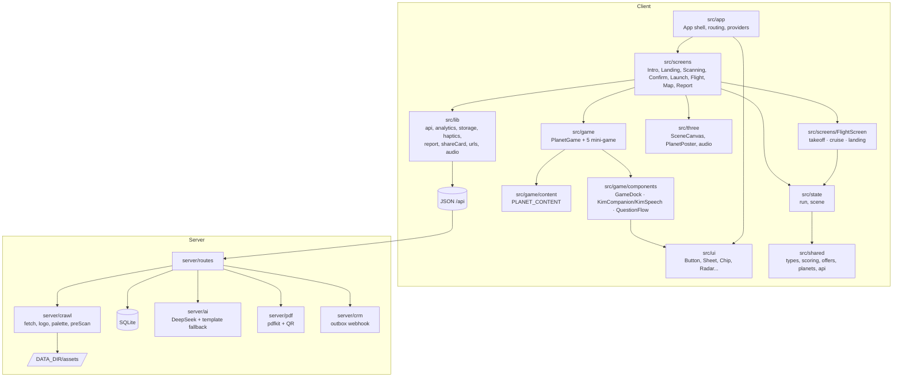
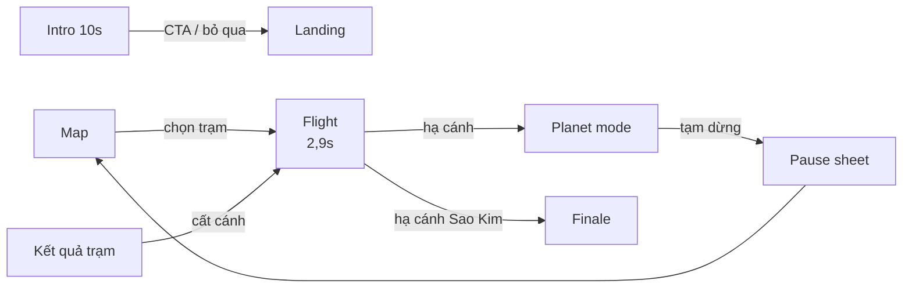
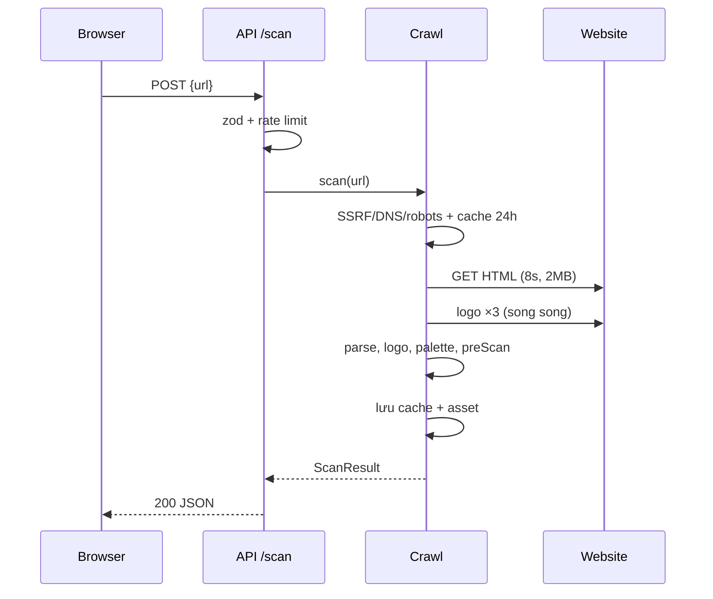
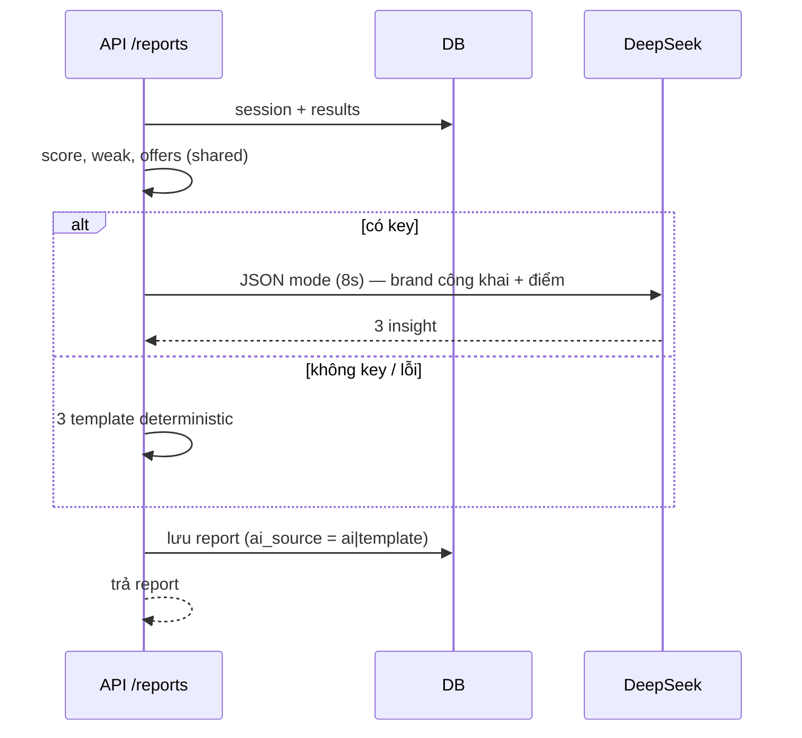
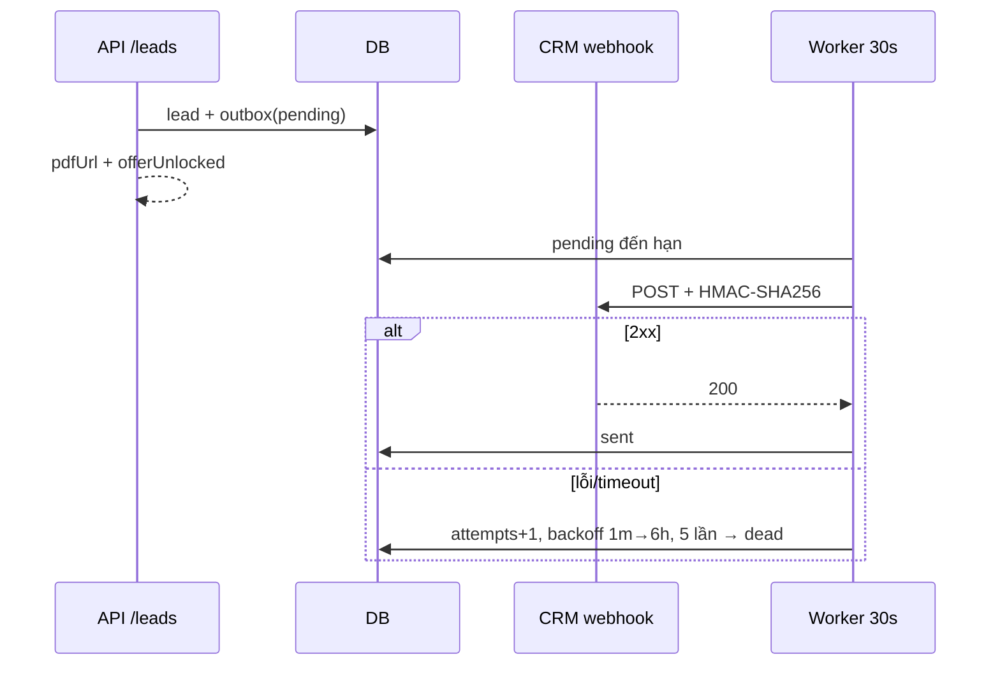

# 07 — Kiến trúc kỹ thuật

Tài liệu chốt stack, module, hợp đồng API, schema dữ liệu, luồng tuần tự, bảo mật/pháp lý, triển khai và ngân sách hiệu năng. Đối chiếu code: `src/**` (client), `server/**` (API), `vite.config.ts`, `.env.example`, `package.json`.

## 1. Stack & lý do

| Lớp | Công nghệ | Phiên bản | Vì sao chọn |
|---|---|---|---|
| Build | Vite | 8.3 | Dev nhanh, code-split tự động, PWA plugin |
| UI | React + TypeScript + Tailwind | 19.3 / 5.9 / 4.3 | Hệ sinh thái, strict type, token nhanh, bundle nhỏ |
| 3D | three + @react-three/fiber | 0.187 / 9.8 | Shader hành tinh, sprite, camera rig; R3F quản lý vòng đời |
| State | zustand | 5.1 | Store nhỏ, không provider, đọc ngoài React được (scene) |
| Font | Be Vietnam Pro (self-host) | 5.3 | Tiếng Việt đủ dấu, không gọi Google Fonts (riêng tư + tốc độ) |
| Server | Hono + @hono/node-server | 4.13 / 2.1 | Nhẹ, Web Standard, middleware rõ ràng |
| DB | `node:sqlite` | Node 24 | Một file, không cần dịch vụ ngoài, đủ cho MVP |
| Crawl | cheerio + robots-parser + iconv-lite | 1.2 / 3.0 / 0.7 | Parse HTML/CSS, tôn trọng robots, xử lý charset Việt |
| Ảnh | sharp | 0.35 | Resize/trim/normalize logo, nhanh, không cần native khác |
| Validate | zod | 4.6 | Một schema dùng client + server (`src/shared/api.ts`) |
| PDF | pdfkit + font TTF tiếng Việt | 0.20 | Báo cáo 3 trang, kèm QR (qrcode) |
| Storage client | idb-keyval | 6.3 | Resume/offline, fallback localStorage |
| PWA | vite-plugin-pwa | 2.0 | Precache shell, runtime cache asset |

Ràng buộc: **không thêm dependency nặng cho 3D** (không postprocessing, không physics), **không asset ngoài brand + procedural**, **không dịch vụ ngoài bắt buộc** (AI/CRM là tuỳ chọn).

## 2. Sơ đồ module



Quy tắc phụ thuộc: `src/shared` không import DOM/Node; `src/three` không import `src/screens`; `src/game` không phụ thuộc 3D; server không import từ `src/game/content` trực tiếp trừ khi cần validate.

## 3. Scene, flight, popup, desktop, 2.5D

### 3.1 Scene mode & chuyến bay giữa trạm

- `SceneMode = "intro" | "landing" | "launch" | "planet" | "finale" | "flight"`; store `useScene` giữ thêm `flight: FlightState | null`.
- `FlightState = { from: PlanetId | null; to: PlanetId | "venus"; startedAt; duration }`. `startFlight({ from, to, duration? })` đặt mode `flight`, planet đích; `endFlight()` xoá flight.
- Mặc định 2.900ms; reduced motion 650ms. Ba pha theo tỉ lệ 0,25 / 0,5 / 0,25: takeoff 0,7s · cruise 1,4s · landing 0,7s.
- `FlightScreen` (overlay full-screen) phát `flight_start`, `flight_complete`, `flight_skip`; hết thời lượng gọi `onLanded`, bấm skip gọi `onSkip`.
- `App` giữ `flight = { plan, next }`: map hoặc kết quả trạm gọi `startFlight`, khi hạ cánh mới mở trạm kế / finale — nên **không có bản đồ giữa hai trạm**. Bản đồ chỉ mở qua pause sheet hoặc resume.
- Không đổi API/DB: chuyến bay là state client + scene mode.



### 3.2 Popup câu hỏi & Sheet

- `QuestionFlowProvider` bọc mini-game; mỗi `QuestionAnchor` chỉ đăng ký câu hỏi, không render inline. Provider giữ hàng đợi FIFO và mở **một `Sheet`** tại một thời điểm.
- `Sheet` có 2 biến thể: `bottom` (< 900px) và `center` (≥ 900px); tự khoá `body overflow`, focus trap, Esc/backdrop/X đóng.
- Đóng popup = ẩn tạm: câu thu thành pill "Câu hỏi X/N đang chờ" trong khung game; chạm pill mở lại. Trả lời xong: 3 đáp án thu gọn thành một dòng `question-chosen`, feedback có mặt KIM + explain hiện dưới; footer dính đổi thành "Tiếp tục".
- Khi popup mở hoặc đang ẩn chờ, `useQuestionFlow().paused = true`; mini-game dùng cờ này để dừng đồng hồ (IM dừng trừ meter).
- `ms` của `DecisionRecord` đo từ lần đầu popup thực sự hiện câu (`onShown`).
- 11 điểm mount `QuestionAnchor` phủ 18 quyết định: S 1 neo trong vòng lặp (render tối đa 4 lần), A 2, O 3, K 4, IM 1 neo tái sử dụng cho 4 mốc tháng.
- Popup dùng `Sheet` biến thể `sheet--question` (max-height 92dvh/760px): không cần cuộn cho 1 câu + 3 đáp án ở viewport chuẩn; sau khi chọn, thân popup tự đưa feedback lên đầu.
- Test ID: `question-modal`, `question-pill`, `question-hide`, `question-continue`, `question-option-{id}`, `question-chosen`, `question-feedback`.

### 3.3 Desktop layout

| Breakpoint | Layout | Popup |
|---|---|---|
| < 900px | một cột, CTA đáy, safe area | bottom sheet |
| 900–1199px | một cột, trang cuộn tự do | center modal |
| 900–1199px | một cột; panel trạm thành console nổi bên phải khi cao ≥ 640px (min(420px, 40vw), tối thiểu 340px) | center modal |
| ≥ 1200px | landing 2 cột; map có `MapOrbit`; console phải 440px, thu gọn/mở lại; report 2 cột | center modal |
| ≥ 1600px | như ≥ 1200, nội dung giới hạn (map 1240px, report 1180px, landing copy 610px) | center modal |

`useIsConsole()` (≥ 900px và cao ≥ 640px) quyết định panel phải; `useIsDesktop()` (≥ 1200px) bật thu gọn/orbit; `useIsWide()` (≥ 1600px) dự phòng. QA chạy 1440×900, 1920×1080 và các viewport fold/duo 344×882, 725×870, 540×720, 884×1104.

### 3.4 Quality tier & 2.5D

- `SceneCanvas()` cố định toàn màn hình, `pointer-events: none`; UI nằm trên canvas. Hành tinh và 5 lớp sáng đọc từ `PlanetResult` (`litLayersFromResults`).

| Tier | Điều kiện | Cấu hình |
|---|---|---|
| `high` | WebGL2, `deviceMemory ≥ 6`, `hardwareConcurrency ≥ 6` | dpr ≤ 1.5, đủ hạt, đủ sao, bóng đơn giản |
| `mid` | WebGL2, máy tầm trung | dpr ≤ 1.25, giảm hạt 50/100, tắt parallax phụ |
| `low` | Không WebGL2 / `saveData` / reduced-motion / fps < 40 trong 3s | **2.5D**: `PlanetPoster`/`PlanetBackdrop` SVG/CSS, không canvas; chuyến bay dùng tên lửa CSS |

- Auto-downgrade một lần, không nâng lại trong phiên. `?quality=low|mid|high` để QA/test.
- Dọn dẹp: huỷ RAF, listener, renderer khi unmount; không giữ context WebGL sau khi rời game.

### 3.5 Intro 3D (lần đầu)

- `IntroScreen` là overlay trước landing, dùng `SceneMode "intro"`: camera gần hơn landing, `INTRO_DOLLY_SECONDS = 10`; 5 nhịp `site.timing.introStepsMs = [0, 1800, 3700, 5600, 7400]`, CTA ở `introCtaMs = 8800`. Không tự chuyển: CTA/skip gọi `onFinish` → App đóng intro, sang landing.
- `App` đọc `readIntroPreference()` từ `src/lib/intro.ts`: `?intro=0` bỏ, `?intro=1` ép, mặc định mở nếu chưa có `localStorage["saokim:intro:v1"]` **và** không có bản lưu resume. Khi xong: `markIntroSeen()` + `clearIntroParam()`.
- Replay từ landing (`IntroScreen replay`) ghi `intro_replay`; đóng intro luôn chuyển mode scene về landing.
- `show3D = introOpen || flight || screen ∈ {launch, planet, finale}` → intro có 3D; tier low dùng poster 2.5D + rail CSS.
- Intro **không đổi API/DB**, không gọi crawl; chỉ là màn client + localStorage.

### 3.6 Cockpit trạm 2.0, dock & KIM

- `PlanetHostScreen` là cockpit: panel trạm đổi chiều cao theo pha `intro | playing | result`, hành tinh 3D phía sau. Một vùng cuộn duy nhất (`kim-game__body`); header HUD và dock đứng yên.
- `GameDockProvider` + `GameDockSlot` + `GameDock`: mini-game portal CTA vào slot ngoài vùng cuộn, nên nút chính không bao giờ bị nội dung đẩy khuất. Mỗi pha chỉ có 1 CTA; `disabled` khi chưa đủ điều kiện.
- `KimCompanion` (SVG + CSS 3D, 4 mood, miệng nói) và `KimSpeech` (bubble + typewriter 16–38ms/ký tự, sr-only live region) dùng ở HUD, intro, popup và kết quả trạm. Reduced motion → hiện đủ câu ngay.
- Panel tiers: intro `min(62dvh, 100dvh−110px, 560px)`; playing `min(84dvh, 100dvh−96px, 860px)`; result `min(82dvh, 100dvh−104px, 820px)`; máy cao < 700px dùng 66/87/86dvh. Console phải ở `≥ 900px & ≥ 640px`; landscape thấp (`700–899px`, cao < 640px) console hẹp; rất thấp (`< 700px rộng, cao < 560px`) panel toàn màn hình.
- Trạm 2.0 chỉ thay client (component + CSS); **không đổi API, schema DB hay payload `PlanetGameProps`**.

## 4. Audio synth

- WebAudio, không file; `src/lib/audio.ts` API: `initAudio()`, `enableAudio()`, `setSoundEnabled(bool)`, `playSfx(name)`, `setAmbience(planet|null)`, `stopAll()`. `AudioDirector` giữ pad thiên hà theo màn hình/trạm; mặc định bật, lần gesture đầu mở khoá, lựa chọn lưu `saokim:sound:v1` (`src/lib/audioPrefs.ts`). SFX `type` (gõ chữ KIM) và `answer` (chốt đáp án quiz) là synth nhẹ, không file.
- `AudioContext` chỉ tạo sau gesture; nhớ lựa chọn tắt/bật ở localStorage; mặc định bật.
- Mỗi trạm một pad hợp âm; crossfade 800ms khi chuyển trạm; SFX ngắn ≤ 1s (`launch`, `warp`, `landing` cho chuyến bay). Không autoplay; khi tab ẩn, hạ âm lượng về 0 và dừng ambience.

## 5. API

Tất cả JSON; lỗi trả `{ code, message }` với `message` là câu tiếng Việt hiển thị được. Rate limit theo IP hash: 240 request/phút chung, 10 scan/phút, 10 lead/phút, 120 event/phút.

| Method | Path | Input | Output | Ghi chú |
|---|---|---|---|---|
| POST | `/api/scan` | `ScanRequest` | `ScanResult` | Cache 24h; fallback nhập tay qua `manual` |
| POST | `/api/logo` | multipart `logo` ≤ 2MB | `BrandLogo` | sharp, strip EXIF |
| POST | `/api/sessions` | `CreateSessionInput` | `{ sessionId }` | Lưu brand + answers + consent version |
| PATCH | `/api/sessions/:id` | `SaveProgressInput` | `{ ok }` | Lưu `currentPlanet`, `completed`, results/decisions |
| POST | `/api/reports` | `CreateReportInput` | `{ report }` | Tính lại điểm server-side bằng `src/shared/scoring` |
| GET | `/api/reports/:id` | — | `{ report }` | Bản public không PII cho link share; gate lead nằm ở UI |
| POST | `/api/leads` | `LeadInput` | `{ ok, pdfUrl, offerUnlocked }` | Consent bắt buộc, honeypot rỗng, token PDF |
| GET | `/api/reports/:id/pdf?token=` | — | PDF | Token HMAC, hết hạn 7 ngày |
| GET/POST | `/api/leaderboard` | `LeaderboardSubmit` (POST) | `{ entries }` / `{ entry }` | Top 20, chỉ `visible = 1`; alias, ẩn danh, tuỳ chọn ngành |
| POST | `/api/events` | `EventBatch` ≤ 30 | `{ ok }` | Batch, best-effort, không chặn UI |
| GET | `/api/assets/:id` | — | PNG | Immutable 7 ngày |
| GET | `/api/qr?data=` | — | PNG | Cho PDF/share |
| GET | `/api/admin/leads.csv?token=` | — | CSV | Chỉ admin, token env |
| GET | `/api/health` | — | `{ ok, version }` | Cho monitoring |

Nguyên tắc: **điểm do server tính lại** bằng cùng module `src/shared/scoring.ts` — client chỉ hiển thị; nếu client gửi điểm khác, server bỏ qua điểm client.

> **Chống sửa điểm:** server recompute bằng `scorePlanet` từ `decisions`; chỉ nhận `score` client lệch trong [−0,05, +bonus trạm] (O +2, K +3, còn lại +0,05). **Cần đóng trước release:** hiện `GET /api/reports/:id` trả đầy đủ `report` (gồm insight/gói) cho bất kỳ ai có `reportId`; gate mới chỉ nằm ở UI. Nên ẩn `insights`/`offers` sau khi có lead, hoặc trả bản ungated + token cho bản đầy đủ. Đã ghi ở [04](04-scoring-offers.md) §10.

## 6. DB schema

SQLite tại `DATA_DIR/app.db`, WAL bật. DDL đầy đủ ở `server/db/index.ts`; không lưu HTML trang crawl.

| Bảng | Cột chính | Index |
|---|---|---|
| `sessions` | id, scan_id, brand_json, answers_json, consent_accepted, consent_version, progress_json, ip_hash, created_at, updated_at | created_at |
| `reports` | id, session_id, report_json, score, industry, created_at | session_id, created_at, (industry, score) |
| `leads` | id, session_id, report_id, name, phone, email, is_representative, consent, consent_version, marketing_opt_in, website, ip_hash, user_agent, created_at | created_at, report_id, session_id |
| `events` | id, name, session_id, planet, props_json, ip_hash, ts, created_at | name, session_id, created_at |
| `leaderboard` | id, session_id (unique), alias, industry, score, title, visible, created_at | (visible, score, created_at), (industry, visible, score) |
| `outbox` | id, type, payload_json, status, attempts, next_attempt_at, last_error, created_at, updated_at | (status, next_attempt_at) |

```sql
CREATE TABLE leads (
  id TEXT PRIMARY KEY,
  session_id TEXT NOT NULL,
  report_id TEXT NOT NULL,
  name TEXT NOT NULL,
  phone TEXT,
  email TEXT,
  is_representative INTEGER NOT NULL DEFAULT 0,
  consent INTEGER NOT NULL DEFAULT 0,
  consent_version TEXT,
  marketing_opt_in INTEGER NOT NULL DEFAULT 0,
  website TEXT,
  ip_hash TEXT,
  user_agent TEXT,
  created_at TEXT NOT NULL
);
```

**Bổ sung trước pilot:** `leads.status` (new → contacted → qualified → booked → booking_confirmed → won/lost), `leads.overall`, `leads.offer_code`, `leads.industry`/`company_size`/`role` để sales lọc. Không thêm cột PII mới khi chưa có mục đích rõ.

## 7. Sequence

### 7.1 Crawl



### 7.2 AI insight



Không gửi tên/SĐT/email vào AI. Prompt chỉ chứa: tên thương hiệu, ngành, 5 điểm trạm, 2 bước yếu, evidence pre-scan.

### 7.3 CRM outbox



## 8. PWA, resume, offline

- `manifest`: name "Hành trình Sao Kim", `display: standalone`, `orientation: portrait`, theme `#050a24`, icon 192/512/maskable. Service worker precache shell; `navigateFallback` trừ `/api/`; runtime `CacheFirst` cho `/api/assets/` 7 ngày/40 mục.
- Không cache `/api/scan`, `/api/reports`, `/api/leads` — tránh lộ dữ liệu trên máy dùng chung. Resume: `RunSnapshot` phiên bản 2 (`RUN_VERSION`), key `saokim:run:<domain>` + `saokim:last-run`; lưu sau mỗi quyết định/trạm; resume nếu < 7 ngày và chưa có report.
- Offline: chơi tiếp bằng state local; event xếp hàng; khi online, PATCH session và POST events; nếu tạo report lỗi, giữ bản local và cho retry.
- `visibilitychange` flush analytics; `pagehide` lưu snapshot.

## 9. Bảo mật & pháp lý

| Hạng mục | Chốt |
|---|---|
| Header | `X-Content-Type-Options: nosniff`, `Referrer-Policy: strict-origin-when-cross-origin`, `Permissions-Policy: camera=(), microphone=(), geolocation=()`, CSP cho HTML tĩnh (script self + inline style cần thiết) |
| Body limit | JSON 3,5MB, multipart upload 2,5MB, file logo 2MB; từ chối sớm theo `Content-Length` |
| Validate | 100/100 input qua zod (`src/shared/api.ts`); không tin `points` từ client |
| Lead | Honeypot `website` phải rỗng; SĐT/email regex; `isRepresentative` và `consent` phải `true`; rate limit 10 lead/phút/IP |
| PDF token | HMAC-SHA256(reportId + exp + secret), hết hạn 7 ngày, không đoán được |
| Admin | `ADMIN_TOKEN` qua header/query cho CSV; không có UI admin trong MVP |
| SSRF | Theo [02](02-crawl.md) §3 |
| Log | Không log PII, không log token, không log URL có query; IP hash bằng `IP_HASH_SALT` |
| Secret | Chỉ trong env; không có trong bundle client (chỉ `VITE_*` được nhúng) |
| NĐ 13/2023 | Consent phiên bản `2026-11-v1`; mục đích rõ; retention 180 ngày; quyền truy cập/xoá/rút đồng ý; đầu mối DPO `[cần xác nhận]` |
| AI | DeepSeek nhận dữ liệu brand công khai (không PII); phải nêu trong privacy; có fallback khi không dùng AI |
| Trẻ vị thành niên | Không thiết kế cho người < 18; không thu dữ liệu nhạy cảm |
| Chuyển dữ liệu ra nước ngoài | Nếu dùng DeepSeek: ghi rõ trong privacy và đánh giá theo NĐ 13 `[cần pháp chế duyệt]` |

## 10. Triển khai & biến môi trường

| Biến | Bắt buộc | Ý nghĩa |
|---|---|---|
| `NODE_ENV` / `HOST` / `PORT` | Không | production bật serve `dist`; host mặc định `127.0.0.1`, production đặt `0.0.0.0` sau proxy; port mặc định 8788 |
| `DIST_DIR` / `SERVE_STATIC` | Không | Thư mục build client (`dist`); `SERVE_STATIC=1` để serve khi chạy dev |
| `BOOKING_URL` | Không | Link đặt lịch server-side (nếu dùng) `[cần xác nhận]` |
| `PDF_TOKEN_SECRET` / `PDF_TOKEN_TTL_MS` | Production | Khoá HMAC link PDF (mặc định dùng `IP_HASH_SALT`, có cảnh báo); hạn token mặc định 7 ngày |
| `CRM_WEBHOOK_TIMEOUT_MS` / `CRM_MAX_ATTEMPTS` | Không | Timeout gọi CRM 5000ms; retry outbox 5 lần |
| `CRAWL_TIMEOUT_MS` / `CRAWL_MAX_HTML_BYTES` | Không | Ghi đè giới hạn crawl (mặc định 8000ms / 2MB) |
| `PUBLIC_ORIGIN` | Có | Origin cho link PDF/share/CORS |
| `DATA_DIR` | Có | Nơi chứa SQLite + assets |
| `IP_HASH_SALT` | Có | Salt hash IP |
| `TRUST_PROXY` | Không | 1 nếu sau reverse proxy set `X-Forwarded-For` |
| `DEEPSEEK_API_KEY` | Không | Có → AI insight; không → template |
| `DEEPSEEK_MODEL` | Không | Mặc định `deepseek-flash` |
| `DEEPSEEK_BASE_URL` | Không | Mặc định `https://api.deepseek.com` |
| `CRM_WEBHOOK_URL` / `CRM_WEBHOOK_SECRET` | Không | Có → đẩy lead; không → SQLite + CSV |
| `ADMIN_TOKEN` | Có ở production | Bảo vệ CSV |
| `VITE_SITE_ORIGIN` | Có | Canonical, share |
| `VITE_BOOKING_URL` | Không | Link đặt lịch `[cần xác nhận]` |
| `VITE_SHOW_PRICE` / `VITE_ENABLE_LEADERBOARD` | Không | Cờ bật/tắt |

Quy trình: `npm run build` → `dist/`; `tsx server/index.ts` serve `dist` + API, SPA fallback trừ `/api/`. Production cần: TLS, reverse proxy, backup SQLite hằng ngày, giám sát `/api/health`, xoay `IP_HASH_SALT`/`ADMIN_TOKEN`, chạy 1 instance (SQLite) hoặc chuyển Postgres khi > 1 instance. Node 24 LTS `[cần xác nhận runtime production]`.

## 11. Ngân sách hiệu năng

| Hạng mục | Ngân sách | Cách đo |
|---|---|---|
| HTML + CSS + JS shell (gzip) | ≤ 800KB | Lighthouse/bundle analyzer |
| Chunk three (lazy, gzip) | ≤ 1.8MB | `import()` tách khỏi shell |
| Tổng tải lần đầu (shell + font + poster) / cả phiên | ≤ 2,5MB / **≤ 5MB** | DevTools 4G throttle, không tính PDF |
| LCP (máy tầm trung, 4G) | ≤ 2.5s | Lighthouse mobile |
| INP | ≤ 200ms | Web Vitals |
| FPS / bộ nhớ JS | ≥ 30 fps (60 ở tier high) / ≤ 300MB | rAF sampler + DevTools memory |
| p95 API `/api/scan` | ≤ 8s | Log server |
| p95 API khác | ≤ 500ms | Log server |
| Bundle font | ≤ 180KB (2 weight, subset vietnamese) | Build output |

Kỹ thuật: lazy `import()` cho `src/three`; font self-host subset; không ảnh raster lớn (poster SVG); service worker cache asset logo; dpr ≤ 1.5; tắt hiệu ứng khi tab ẩn.

## 12. Prototype vs production

| Hạng mục | Hiện tại (MVP) | Cần cho production |
|---|---|---|
| DB | SQLite 1 file | Backup + retention job; Postgres nếu scale ngang |
| Cache crawl | SQLite/bộ nhớ | Redis hoặc CDN nếu nhiều instance |
| AI | DeepSeek nếu có key, fallback template | Timeout, retry, cache theo hash, theo dõi chi phí |
| CRM | Outbox + webhook 1 chiều | 2 chiều, mapping stage, retry có dead-letter |
| Gate báo cáo | UI gate; API `GET /api/reports/:id` trả report không PII cho link share có id khó đoán | Phase 2: token ngắn hạn cho từng lead, ẩn insight/offers nếu chưa xác thực |
| CRM stage | Đã có `leads.status` + `offer_code` + `overall` (migration idempotent) | Đồng bộ 2 chiều + webhook CRM thật ở Phase 2 |
| 3D | Procedural, tier low = poster | Asset thật Draco/KTX2, LOD, VO |

## 13. Liên kết

- Crawl chi tiết: [02](02-crawl.md).
- Hợp đồng gameplay: [03](03-game-design.md) §8.
- Công thức điểm (server dùng lại): [04](04-scoring-offers.md) §1.
- Ma trận thiết bị & tiêu chí đạt: [09](09-mobile-qa.md).
- Event & KPI: [10](10-kpi.md).
