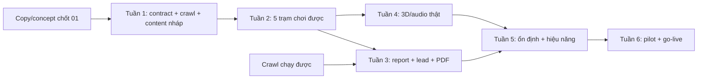

# 08 — Roadmap

Mục tiêu: có một bản chơi được từ đầu đến cuối trong **4–6 tuần**, đủ tốt để chạy pilot với khách thật và đo phễu. Tài liệu chốt thứ tự việc, người chịu trách nhiệm, nghiệm thu từng tuần, phần cắt được khi trễ và Phase 2. Kiến trúc ở [07](07-architecture.md), tiêu chí chất lượng ở [09](09-mobile-qa.md).

## 1. Nguyên tắc lập kế hoạch

1. **Đường găng là crawl + 3D + content**, không phải UI. Làm song song ngay từ tuần 1.
2. **S và K là trạm kỹ thuật nặng** (quét sương nhiều lớp, phóng tàu + khủng hoảng 30 giây). **A, O, IM nhẹ hơn** — làm sau, dùng lại component của S/K.
3. **Luôn có bản chơi được**: cuối tuần 2 phải đi hết 5 trạm với nội dung tạm (text), chưa cần đẹp.
4. **Không chờ đủ 5 trạm mới test mobile**; test trên iPhone SE và Samsung A14 từ tuần 2.
5. **Mỗi tuần có nghiệm thu đo được**, không dùng "đã xong" làm tiêu chí.

## 2. Đội & mã việc

| Mã | Vai trò | Phạm vi |
|---|---|---|
| `L` | Lead / tích hợp | App shell, screens, report, share, PWA, persistence, review cuối |
| `S` | Backend/crawl | `server/**`, crawl, API, DB, AI, CRM, PDF |
| `3D` | 3D/audio | `src/three/**`, `src/lib/audio.ts`, quality tier, poster |
| `G` | Gameplay/content | `src/game/**`, 5 mini-game, 18 quyết định |
| `D` | Docs/QA nội dung | `docs/**`, đối chiếu spec, ma trận test nội dung |
| `BR` | Brand/creative | Ảnh key art, câu chữ, duyệt concept |

## 3. MVP theo tuần

### Tuần 1 — Nền & đường găng

| Việc | Owner | Nghiệm thu |
|---|---|---|
| Chốt hợp đồng dữ liệu (`types.ts`, `api.ts`, `game.ts`), không đổi sau tuần 2 nếu không có lý do | L | Typecheck xanh; 03/04 docs khớp |
| Dựng App shell: `SceneCanvas` giả, routing 8 màn, store `run`/`scene` | L | Đi được landing → confirm → map → report bằng mock |
| Crawl pipeline: SSRF guard, fetch, parse, logo, palette, preScan, cache | S | POST `/api/scan` với 3 domain thật trả brand kit trong ≤ 8s |
| Content 18 quyết định (bản nháp, đủ structure) | G | `PLANET_CONTENT` typecheck; mỗi trạm đủ decision/option/explain |
| Scene nền: starfield, hành tinh shader cơ bản, camera rig 4 mode | 3D | 30fps trên desktop; poster render được |
| Viết 00–05 docs, chốt copy landing/confirm | D | Docs review bởi Lead |

**Mốc:** crawl thật + brand kit hiển thị được trên màn Confirm.

### Tuần 2 — Chơi được từ đầu đến cuối

| Việc | Owner | Nghiệm thu |
|---|---|---|
| Mini-game S (quét sương 4 vùng, tap alternative) + quyết định S | G | Chơi hết S, trả `onDecision` đúng `ms` |
| Mini-game K (xếp 5 việc, giữ nạp phóng, khủng hoảng 30s, `crisisFast`) | G | Hết K trong 90–120s, có `crisisFast` khi < 10s |
| A, O, IM bản tối thiểu (nối sao, 6 mockup, tua 12 tháng) | G | Đi hết 5 trạm, dữ liệu đủ tính điểm |
| `scorePlanet`/`buildRunResult` nối vào store; báo cáo đọc điểm thật | L | Tổng X/10 khớp tính tay ở 04 §4 |
| Report ungated: poster, radar, 2 bước yếu, huy hiệu | L | Không cần lead vẫn xem được |
| Test mobile lần 1: iPhone SE + Samsung A14, tier low | 3D + D | Không crash; 2.5D chạy được |
| Storyboard 8 khoảnh khắc (06) chốt với creative | 3D + BR | Duyệt khung hình |

**Mốc:** một người ngoài đội chơi hết 5 trạm mà không cần hướng dẫn.

### Tuần 3 — Lead gate, báo cáo đầy đủ, dữ liệu

| Việc | Owner | Nghiệm thu |
|---|---|---|
| Session API + PATCH progress + resume IndexedDB | L + S | F5 giữa trạm, mở lại tiếp tục đúng trạm |
| Report API tính điểm server-side, lưu DB | S | Client sửa điểm không ảnh hưởng kết quả |
| Lead gate: form, consent NĐ13, honeypot, PDF token | L + S | Lead lưu SQLite; thiếu consent bị 400 |
| AI insight + fallback template | S | Không có key vẫn có 3 insight; `aiSource` đúng |
| PDF 3 trang + QR, font tiếng Việt | S | PDF mở được, dấu đủ, QR trỏ đúng |
| Offer mapping + `why` theo bước yếu | L | Đúng bảng 04 §5 với 6 kịch bản test |
| Share 9:16 (PNG) | L | Ảnh 1080×1920, đủ thông tin, không lỗi font |

**Mốc:** một lead thật chạy hết phễu đến PDF.

### Tuần 4 — 3D/âm thanh thật, chất lượng cảm xúc

| Việc | Owner | Nghiệm thu |
|---|---|---|
| 5 lớp sáng hành tinh theo điểm từng trạm; vùng tối đúng | 3D | Ảnh chụp 5 trạng thái khớp 06 §8 |
| Finale: camera lùi, sao 4 cánh, tên thương hiệu | 3D | 8–12s, bỏ qua được, tier low vẫn đẹp |
| Audio synth: 5 pad, SFX, mute mặc định, iOS unlock | 3D | Không autoplay; nhớ trạng thái; không rè |
| Cinematic landing + launch, skip đúng | 3D + L | Chạm bỏ qua ≤ 0.6s |
| Leaderboard ngành + share | L | Top 20, ẩn danh mặc định |
| Analytics event đầy đủ theo 10 §3 | L | Batch gửi, không chặn UI, thấy trong DB |
| QA nội dung: không ký hiệu phần trăm, không tên gói trong game, không số liệu bịa | D | Checklist 100/100 mục |

**Mốc:** bản "wow" đủ để quay video demo.

### Tuần 5 — Ổn định, hiệu năng, nội dung cuối

| Việc | Owner | Nghiệm thu |
|---|---|---|
| Giảm bundle: lazy three, subset font, kiểm tra ≤ 5MB | L + 3D | Lighthouse mobile: tải ≤ 5MB, LCP ≤ 2.5s |
| Sửa lỗi từ QA ma trận thiết bị (09 §2) | Tất cả | Không còn P0/P1 |
| Nội dung cuối: 18 quyết định, insight "Bạn có biết", 5 huy hiệu | G + D | Đọc tự nhiên, đúng giọng 01 §6 |
| PDF/share/OG image hoàn chỉnh | L | Ảnh share có logo + điểm + danh hiệu |
| Privacy, consent, retention job, xoá dữ liệu | S | Có job xoá 180 ngày; trang privacy đủ mục |
| Docs cập nhật khớp code cuối | D | 03/04/07 khớp code |

**Mốc:** release candidate, đóng băng tính năng.

### Tuần 6 — Pilot & quyết định

| Việc | Owner | Nghiệm thu |
|---|---|---|
| Pilot nội bộ (đội Sao Kim) + 1 buổi quan sát người dùng thật | L + BR | 5–8 phiên, ghi lại vấn đề |
| Sửa lỗi P0/P1 từ pilot | Tất cả | Không còn P0 |
| Đo phễu 1 tuần, so với giả thuyết 10 §2 | L | Có dashboard hoặc query SQL chạy được |
| Quyết định go/no-go; danh sách việc Phase 2 | Lead | Biên bản + backlog ưu tiên |
| Deploy production, kiểm tra health/backup | S | `/api/health` 200, backup chạy |

**Mốc:** go-live có kiểm soát.

## 4. Đường găng & phụ thuộc

Điểm nghẽn cần bảo vệ: (1) hợp đồng dữ liệu tuần 1; (2) mini-game S và K; (3) PDF font tiếng Việt; (4) tier low trên máy yếu.

## 5. Phần cắt được khi trễ

| Ưu tiên | Hạng mục | Cắt thì thay bằng |
|---|---|---|
| Không cắt | 5 trạm, tính điểm, báo cáo ungated, lead gate, consent | — |
| Cắt 1 | Leaderboard | Ẩn bằng cờ `VITE_ENABLE_LEADERBOARD=0` |
| Cắt 2 | Share 9:16 | Nút "Tải ảnh" đơn giản hơn |
| Cắt 3 | Cinematic landing/launch | Fade 300ms, giữ finale |
| Cắt 4 | AI insight | Template deterministic (đã có sẵn) |
| Cắt 5 | Âm thanh | Tắt âm thanh toàn bộ, giữ nhịp bằng animation |
| Không bao giờ cắt | Consent, privacy, retention, fallback nhập tay, 2.5D | — |

## 6. Pilot

- **Ai:** nhóm nội bộ Sao Kim (đóng vai người chơi và người quan sát) + khách mời do sales chọn; số lượng cụ thể do Lead chốt `[cần xác nhận]`.
- **Cách chạy:** 1 phiên/người, quan sát trực tiếp hoặc record màn hình (có consent), không hướng dẫn trong lúc chơi; phỏng vấn 5 phút sau phiên.
- **Câu hỏi phỏng vấn:** "Bạn nhớ trạm nào nhất?", "Điều gì bạn thấy đúng nhất về thương hiệu của bạn?", "Bạn có tin báo cáo này không? Vì sao?", "Bạn có muốn nhận cuộc gọi tư vấn không?".
- **Tiêu chí thành công pilot** (ngưỡng đặt trước, chưa phải dữ liệu): ≥ 60/100 người chơi hết 5 trạm không cần trợ giúp; ≥ 50/100 người nói báo cáo "đúng ít nhất một điều tôi chưa nghĩ tới"; ≥ 20/100 để lại lead; không lỗi P0.
- **Ghi lại:** mỗi vấn đề thành một dòng backlog có mức P0–P2 theo [09](09-mobile-qa.md) §4.

## 7. Phase 2 (sau pilot)

| Ưu tiên | Hạng mục | Mô tả | Điều kiện bắt đầu |
|---|---|---|---|
| 1 | Asset thật Draco/KTX2 | Hành tinh, tàu, mockup có mô hình thật thay procedural; LOD 3 mức | Bundle hiện tại ổn định, có ngân sách asset |
| 2 | VO tiếng Việt | Giọng KIM thu sẵn cho intro/outro/finale; phụ đề bắt buộc | Chốt kịch bản thoại; có file audio nén |
| 3 | CRM 2 chiều | Đồng bộ stage, owner, lịch sử tương tác; webhook vào | CRM hiện tại có API; có mapping stage |
| 4 | Benchmark ngành | So sánh với trung vị ngành **khi có đủ dữ liệu thật** (không bịa) | ≥ 100 báo cáo/ngành; có cách ẩn danh |
| 5 | A/B test | Landing headline, độ dài intro, vị trí lead gate | Có traffic đủ để chia nhóm |
| 6 | Sales console | Danh sách lead, báo cáo, gợi ý mở đầu cuộc gọi, trạng thái | CRM 1 chiều ổn định |
| 7 | Đa ngôn ngữ | English cho khách nước ngoài; cấu trúc i18n | Copy tiếng Việt đã ổn định |

Thứ tự này có thể đổi nếu dữ liệu pilot chỉ ra vấn đề khác (ví dụ lead gate đặt sai chỗ).

## 8. Rủi ro tiến độ

| Rủi ro | Xác suất | Ảnh hưởng | Đối sách |
|---|---|---|---|
| Crawl không ổn định với domain Việt | Trung bình | Cao | Ưu tiên nhập tay; bộ fixture test; cache; thêm nguồn logo |
| 3D không đạt 30fps trên máy tầm trung | Trung bình | Cao | Tier low 2.5D là mặc định an toàn; test tuần 2 |
| Nội dung 18 quyết định bị "nhạt" | Trung bình | Cao | Review bởi brand + 1 người ngoài ngành; sửa trước tuần 5 |
| Lead gate làm rơi phễu | Thấp | Cao | Đo A/B sau pilot; không chặn báo cáo ungated |
| Pháp lý chậm duyệt privacy/DPO | Trung bình | Trung bình | Dùng placeholder rõ, không deploy khi chưa duyệt nội dung consent |
| Scope creep (thêm trạm, thêm ngôn ngữ) | Cao | Trung bình | Bảng cắt được §5; mọi thêm mới vào Phase 2 |

## 9. Definition of Done

- 5 trạm chơi hết trên 3 thiết bị đại diện (iPhone SE, Samsung A14, Chrome desktop).
- Tổng X/10 khớp công thức 04; 2 bước yếu, danh hiệu, huy hiệu đúng.
- Báo cáo ungated không cần lead; gate chỉ sau đó.
- PDF tiếng Việt đúng dấu, có QR; lead lưu DB; consent version đúng.
- Consent/privacy/retention có trong code và UI; DPO/địa chỉ placeholder rõ.
- Tải lần đầu ≤ 5MB; 30fps; không P0/P1 mở.
- Event đủ để dựng phễu 10 §3; dashboard hoặc SQL chạy được.
- Docs 00–10 khớp code; README cập nhật.

## 10. Liên kết

- Kiến trúc, ngân sách hiệu năng: [07](07-architecture.md).
- Ma trận thiết bị & mức lỗi: [09](09-mobile-qa.md).
- Phễu, event, SLA: [10](10-kpi.md).
