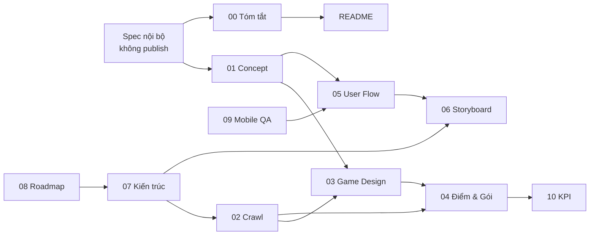

# Hồ sơ sản phẩm — Hành trình Sao Kim

Bộ tài liệu publish cho **Hành trình Sao Kim**, game web 3D mobile-first của Sao Kim Branding: người chơi nhập website doanh nghiệp, hệ thống crawl và dựng brand kit, chơi 5 trạm S–A–O–K–IM, nhận **Bản đồ thương hiệu** kèm gói dịch vụ đề xuất và lịch tư vấn.

Tài liệu viết cho 5 nhóm đọc khác nhau: người quyết định (CEO/CMO Sao Kim), người thiết kế trải nghiệm, người build (frontend/backend/3D), người bán hàng, người QA. Mỗi file tự đứng được, nhưng các con số và tên gọi chỉ có một nguồn: `docs/_internal-spec.md` (nội bộ, **không publish**) và code trong `src/shared/`.

## 1. Mục lục

| # | Tài liệu | Nội dung cốt lõi | Trạng thái | Đối tượng chính |
|---|---|---|---|---|
| 00 | [Tóm tắt](00-tom-tat.md) | Vấn đề, concept, 5 trạm, khác biệt, gói, KPI mục tiêu, phạm vi | Chốt — cập nhật 11/2026 (chuyến bay, popup) | Tất cả |
| 01 | [Concept](01-concept.md) | Tên, logline, intro 10s, câu chuyện, ẩn dụ 5 trạm, KIM, giọng điệu | Chốt — cập nhật 11/2026 (intro) | Brand, creative |
| 02 | [Crawl & Brand Kit](02-crawl.md) | Luồng crawl, logo priority, màu OKLab, pre-scan 5 tiêu chí, lỗi–fallback, quyền riêng tư | Chốt — đã đối chiếu `server/crawl` | Backend, product |
| 03 | [Game Design](03-game-design.md) | Intro 10s, Trạm 2.0 cockpit/dock/popup, 18 quyết định + quy chuẩn copy | Chốt — cập nhật 11/2026 (intro + copy pass) | Game designer, frontend |
| 04 | [Điểm & Gói](04-scoring-offers.md) | Công thức, ví dụ tính tay, reality check, map gói thật, AI insight, gate | Chốt — khớp `src/shared/scoring.ts`, `offers.ts` | Product, sales |
| 05 | [User Flow](05-user-flow.md) | Flow intro→landing→CTA, 13 screen, chuyến bay, cockpit, fold/duo, lỗi/resume | Chốt — cập nhật 11/2026 (intro) | Product, frontend |
| 06 | [Storyboard](06-storyboard.md) | Khoảnh khắc 0 intro + 8 khoảnh khắc, cockpit/KIM, sương thật | Chốt — cập nhật 11/2026 (intro) | 3D, creative |
| 07 | [Kiến trúc](07-architecture.md) | Stack, scene intro/flight/cockpit, IntroScreen, GameDock, KIM, API/DB, budget | Chốt — cập nhật 11/2026 (intro) | Kỹ thuật |
| 08 | [Roadmap](08-roadmap.md) | MVP 4–6 tuần theo tuần, pilot, Phase 2 | Chốt | Lead, delivery |
| 09 | [Mobile QA](09-mobile-qa.md) | Ma trận thiết bị/browser/webview + desktop/tablet/fold/duo/intro, tiêu chí, checklist | Chốt — cập nhật 11/2026 (intro) | QA, frontend |
| 10 | [KPI](10-kpi.md) | Phễu (intro→landing→CTA), event dictionary, mục tiêu x/100, SQL, CRM, SLA | Chốt — KPI là giả thuyết | Marketing, sales |

Trạng thái "Chốt" nghĩa là nội dung đã đủ để build; khi code lệch tài liệu, xử lý theo mục 5.

## 2. Cách đọc theo vai trò

**Người quyết định (10 phút).** Đọc [00](00-tom-tat.md) → [01](01-concept.md) §1–§4 → [04](04-scoring-offers.md) §7–§8 (gói & map gói) → [10](10-kpi.md) §2 (mục tiêu) → [08](08-roadmap.md) §3 (mốc MVP). Bỏ qua phần kỹ thuật.

**Người thiết kế trải nghiệm (40 phút).** [01](01-concept.md) → [03](03-game-design.md) → [05](05-user-flow.md) → [06](06-storyboard.md) → [09](09-mobile-qa.md) §4 (tiêu chí đạt).

**Người build (60 phút).** [07](07-architecture.md) → [02](02-crawl.md) → [03](03-game-design.md) (contract `onDecision`/`onComplete`) → [04](04-scoring-offers.md) §1–§3 → [09](09-mobile-qa.md).

**Sales / CS (20 phút).** [04](04-scoring-offers.md) §5–§8 và §10 (danh hiệu, gói, lead gate, share) → [10](10-kpi.md) §5–§6 (CRM, SLA).

**QA (30 phút).** [09](09-mobile-qa.md) toàn bộ → [05](05-user-flow.md) §6 (trạng thái lỗi) → [03](03-game-design.md) §9 (a11y, timer).

## 3. Bản đồ tài liệu

Luồng dữ liệu chính: crawl trả `BrandProfile` + `PreScan` → người chơi xác nhận → chuyến bay mở trạm → 5 trạm trả `DecisionRecord[]` → `scorePlanet`/`buildRunResult` → `weaknessesFor`/`recommendOffers` → báo cáo → lead → CRM.

### 3.1 Thư viện ảnh màn hình

Ảnh chụp từ bản build, dùng cho review nội bộ và tài liệu bán hàng (không ship vào game). Bộ ảnh nằm trong [`assets/screens/`](assets/screens/), gồm desktop 1440/1920, mobile 390, Trạm 2.0 và fold/duo.

| Ảnh | Nội dung | Link |
|---|---|---|
| Intro mobile | Intro 3D 10s, rail 5 trạm, CTA | [intro.jpg](assets/screens/intro.jpg) |
| Intro desktop | Intro 2 cột 1440×900 | [desktop-intro.jpg](assets/screens/desktop-intro.jpg) |
| Landing | Hero, ô nhập website, hành tinh ngủ | [landing.jpg](assets/screens/landing.jpg) |
| Bản đồ | 5 trạm + thẻ sức khoẻ thương hiệu | [ban-do.jpg](assets/screens/ban-do.jpg) |
| Trạm S | Sương thật, tín hiệu bị che, dock CTA | [tram-s.jpg](assets/screens/tram-s.jpg) |
| Trạm A | Icon chòm sao, horizon 1/3/5 năm | [tram-a.jpg](assets/screens/tram-a.jpg) |
| Trạm O | 6 mockup, đồng hồ tìm lỗi | [tram-o.jpg](assets/screens/tram-o.jpg) |
| Trạm K | Bệ phóng, xếp 5 việc | [tram-k.jpg](assets/screens/tram-k.jpg) |
| Trạm IM | 12 tháng, đồng hồ nhất quán | [tram-im.jpg](assets/screens/tram-im.jpg) |
| Kết quả trạm | X/10, huy hiệu, KIM chốt trạm | [ket-qua-tram.jpg](assets/screens/ket-qua-tram.jpg) |
| Báo cáo | Bản đồ thương hiệu ungated | [bao-cao.jpg](assets/screens/bao-cao.jpg) |
| Gói đề xuất | 2 gói + vì sao | [goi-de-xuat.jpg](assets/screens/goi-de-xuat.jpg) |
| Share 9:16 | Thẻ chia sẻ | [the-chia-se.jpg](assets/screens/the-chia-se.jpg) |
| Low tier | 2.5D fallback | [tram-low-tier.jpg](assets/screens/tram-low-tier.jpg) |
| Desktop landing | 2 cột 1440×900 | [desktop-landing.jpg](assets/screens/desktop-landing.jpg) |
| Desktop map | Orbit stage + sidebar | [desktop-map.jpg](assets/screens/desktop-map.jpg) |
| Desktop flight | Tên lửa cất cánh/bay | [desktop-flight.jpg](assets/screens/desktop-flight.jpg) |
| Desktop question | Popup một câu | [desktop-question.jpg](assets/screens/desktop-question.jpg) |
| Desktop console | Stage 3D + panel phải | [desktop-planet.jpg](assets/screens/desktop-planet.jpg) |
| Desktop report | Báo cáo 2 cột | [desktop-report.jpg](assets/screens/desktop-report.jpg) |
| Venus flight | Chuyến bay cuối | [desktop-venus-flight.jpg](assets/screens/desktop-venus-flight.jpg) |
| Mobile flight | Chuyến bay dọc | [mobile-flight.jpg](assets/screens/mobile-flight.jpg) |
| Mobile question | Popup bottom sheet | [mobile-question.jpg](assets/screens/mobile-question.jpg) |
| Wide 1920 | Landing màn lớn | [wide-landing.jpg](assets/screens/wide-landing.jpg) |
| Fold cover | 344×882, cockpit đáy | [fold-cover.jpg](assets/screens/fold-cover.jpg) |
| Fold inner | 725×870, console rộng | [fold-inner.jpg](assets/screens/fold-inner.jpg) |
| Duo | 540×720, cockpit đáy | [duo.jpg](assets/screens/duo.jpg) |
| Fold large | 884×1104, cockpit đáy | [fold-large.jpg](assets/screens/fold-large.jpg) |

## 4. Quy ước

- **Điểm:** thang 0–10, một số lẻ (ví dụ 7.4/10). Trong game dùng "X/10", số sao (0–5, bước 0,5), "n/5 tín hiệu".
- **KPI:** dùng **x/100** thay cho phần trăm. Mục tiêu KPI là **giả thuyết** cần đo, không phải cam kết.
- **Không dùng ký hiệu phần trăm trong copy UI.** Tài liệu cũng tránh ký hiệu này để tránh lọt vào chuỗi dịch.
- **Không joystick.** Mọi thao tác một ngón tay (tap/rê/kéo/giữ); mọi thao tác kéo/rê có phương án tap.
- **Không bịa số liệu** về khách hàng, đối thủ, benchmark hay hiệu quả dịch vụ. Chỗ cần số thật ghi `[cần xác nhận]`.
- **Placeholder pháp lý:** pháp nhân, địa chỉ, DPO, hotline, link đặt lịch, thời hạn giá — ghi rõ `[cần xác nhận]` trong tài liệu và UI.
- **Tên gói/giá** chỉ lấy từ catalog trong `src/shared/offers.ts`. Không tự đặt giá mới.
- **Đồng bộ code:** [03](03-game-design.md) và [04](04-scoring-offers.md) phải khớp `src/game/content/index.ts` và `src/shared/scoring.ts`; [07](07-architecture.md) phải khớp `server/**`. Khi lệch, code là bản đang chạy nhưng **spec là bản chốt** — Lead quyết định rồi cập nhật docs.

### 4.1 Quy ước đặt tên & phiên bản

- File đánh số `00`–`10` theo thứ tự đọc; số thứ tự không đổi khi thêm tài liệu mới (thêm thì dùng số tiếp theo, không chèn).
- Tên file dùng kebab-case, không dấu, không viết hoa: `03-game-design.md`.
- Mỗi tài liệu có dòng "Trạng thái" trong bảng §1; khi nội dung thay đổi, cập nhật bảng §7.
- Không đổi tên file đã publish vì link chia sẻ nội bộ có thể đã tồn tại.

## 5. Nguồn sự thật & xử lý lệch

1. `docs/_internal-spec.md` — spec nội bộ, không publish. Chứa quyết định gốc về câu chuyện, công thức điểm, catalog gói.
2. `src/shared/*.ts` — hợp đồng dữ liệu và công thức đang chạy: `types.ts`, `scoring.ts`, `offers.ts`, `planets.ts`, `api.ts`, `game.ts`.
3. `src/game/content/index.ts` — nội dung 5 trạm; là nguồn cho bảng quyết định ở [03](03-game-design.md).
4. `src/three/**`, `server/**` — triển khai; tài liệu mô tả ý định, code mô tả hiện trạng.

Khi phát hiện lệch: ghi vào mục "Việc còn mở" của file liên quan, báo Lead, không tự sửa code ngoài write scope `docs/**`.

## 6. Việc còn mở trước khi publish

| Hạng mục | Chỗ xuất hiện | Cần ai chốt | Điều kiện đóng |
|---|---|---|---|
| Pháp nhân, địa chỉ, MST | `05` §4.10, `07` §9, trang privacy | Pháp chế | Điền vào `src/config/legal.ts` + UI |
| DPO / đầu mối xử lý yêu cầu dữ liệu | `05` §4.10, `10` §9 | Pháp chế | Tên + email + SLA phản hồi |
| Link đặt lịch (Calendly/CRM) | `05` §4.10, `10` §6 | Sales ops | `VITE_BOOKING_URL` có giá trị thật |
| Hotline, email liên hệ | `04` §10, `05` §4.10 | Marketing | Xác nhận số đang dùng |
| Thời hạn hiệu lực của khoảng giá | `04` §7, PDF | Sales | Ghi "giá tham khảo, hiệu lực đến ..." |
| Tuyên bố "hơn 10.000 dự án" trong ảnh framework | `01` §8 | Marketing | Chỉ dùng nếu có tài liệu chứng minh |
| Domain production, hạ tầng | `07` §10 | Kỹ thuật | Chốt hosting + biến môi trường |
| Benchmark ngành | `08` §7, `10` §8 | Marketing | Cần dữ liệu thật mới bật tính năng |

## 7. Lịch sử thay đổi

| Phiên bản | Ngày | Thay đổi |
|---|---|---|
| 0.9 | 11/2026 | Bộ 11 tài liệu đầu tiên, khớp spec nội bộ và code `src/shared` |
| 0.10 | 11/2026 | Cập nhật flight giữa trạm, popup một câu (QuestionFlow), desktop 1440/1920: 00, 03, 05, 06, 07, 09, 10, README |
| 0.11 | 11/2026 | Trạm 2.0: cockpit một vùng cuộn, dock CTA, popup compact, KIM, sương thật, A horizon/850ms, fold/duo: 03, 05, 06, 07, 09, README; bổ sung ảnh trạm 2.0 + fold/duo |
| 0.12 | 11/2026 | Intro 3D + copy pass 18 câu + gallery intro: 01, 03, 04, 05, 06, 07, 09, 10, README |
| 0.13 | 11/2026 | Mobile intro: tàu bay vòng quanh; âm thanh nền mặc định bật, nhớ lựa chọn; intro kéo dài 10s, CTA 8,8s: 01, 03, 05, 06, 07, 09, README |
| 0.14 | 11/2026 | Nhạc nền chill hơn, SFX gõ chữ/quiz, nút Xem lại intro ở header, rocket luôn ở phía trước: 03, 05, 06, 07, 09, README |

Khi cập nhật: sửa bảng ở file tương ứng, cộng dòng vào bảng này, và ghi rõ tài liệu nào bị ảnh hưởng.
